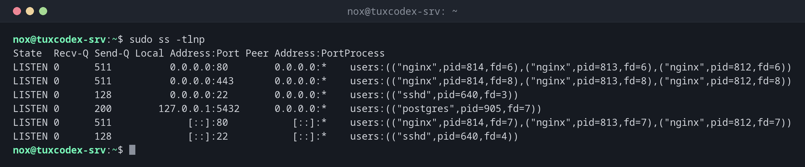

# ss

> Zeigt Netzwerkverbindungen und lauschende Ports: welches Programm auf welchem Port lauscht und wer gerade mit dem Server verbunden ist.



## Syntax

```bash
ss [OPTION]... [FILTER]
```

## Optionen

| Option | Beschreibung |
|--------|--------------|
| `-t`, `-u` | Nur TCP oder nur UDP |
| `-l` | Nur lauschende Sockets (Server, die auf Verbindungen warten) |
| `-n` | Portnummern statt Namen zeigen (`22` statt `ssh`) |
| `-p` | Den Prozess zeigen, braucht für Prozesse anderer Benutzer `sudo` |
| `-a` | Alle Sockets, lauschende und verbundene |
| `-s` | Zusammenfassende Statistik |
| `state ZUSTAND` | Nach Zustand filtern, z. B. `state established` |
| `'dport = :PORT'` | Nach Zielport filtern (`sport` für den Quellport) |

## Beispiele

**Anzeigen, welche Programme auf welchen Ports lauschen:**

```bash
sudo ss -tlnp
```

```text
State  Recv-Q Send-Q Local Address:Port Peer Address:PortProcess
LISTEN 0      511          0.0.0.0:80        0.0.0.0:*    users:(("nginx",pid=814,fd=6),("nginx",pid=813,fd=6),("nginx",pid=812,fd=6))
LISTEN 0      511          0.0.0.0:443       0.0.0.0:*    users:(("nginx",pid=814,fd=8),("nginx",pid=813,fd=8),("nginx",pid=812,fd=8))
LISTEN 0      128          0.0.0.0:22        0.0.0.0:*    users:(("sshd",pid=640,fd=3))
LISTEN 0      200        127.0.0.1:5432      0.0.0.0:*    users:(("postgres",pid=905,fd=7))
LISTEN 0      511             [::]:80           [::]:*    users:(("nginx",pid=814,fd=7),("nginx",pid=813,fd=7),("nginx",pid=812,fd=7))
LISTEN 0      128             [::]:22           [::]:*    users:(("sshd",pid=640,fd=4))
```

| Spalte | Bedeutung |
|--------|-----------|
| `Local Address` | `0.0.0.0` und `[::]`: von überall erreichbar; `127.0.0.1`: nur vom Server selbst |
| `Port` | Der Port, auf dem das Programm lauscht |
| `Process` | Programmname und PID |

PostgreSQL lauscht nur auf `127.0.0.1` und ist damit von außen nicht erreichbar. Genau so
soll es sein.

**Dasselbe ohne `sudo`, nur die Ports:**

```bash
ss -tln
```

```text
State  Recv-Q Send-Q Local Address:Port Peer Address:Port
LISTEN 0      511          0.0.0.0:80        0.0.0.0:*
LISTEN 0      511          0.0.0.0:443       0.0.0.0:*
LISTEN 0      128          0.0.0.0:22        0.0.0.0:*
LISTEN 0      200        127.0.0.1:5432      0.0.0.0:*
LISTEN 0      511             [::]:80           [::]:*
LISTEN 0      128             [::]:22           [::]:*
```

**Die bestehenden TCP-Verbindungen anzeigen:**

```bash
ss -tn state established
```

```text
Recv-Q Send-Q Local Address:Port  Peer Address:Port Process
0      0         192.0.2.10:22   198.51.100.23:51732
0      0         192.0.2.10:443     192.0.2.45:60418
0      0         192.0.2.10:443   198.51.100.7:41220
```

Eine SSH-Sitzung und zwei HTTPS-Verbindungen. Mit `state` fällt die Spalte `State` weg.

**Alle Verbindungen zur Datenbank anzeigen:**

```bash
sudo ss -tnp 'dport = :5432'
```

```text
State Recv-Q Send-Q Local Address:Port  Peer Address:PortProcess
ESTAB 0      0          127.0.0.1:41876    127.0.0.1:5432 users:(("php-fpm8.4",pid=1312,fd=11))
ESTAB 0      0          127.0.0.1:41890    127.0.0.1:5432 users:(("php-fpm8.4",pid=1313,fd=11))
```

**Verbindungen zählen:**

```bash
ss -s
```

```text
Total: 187
TCP:   14 (estab 6, closed 2, orphaned 0, timewait 2)

Transport Total     IP        IPv6
RAW       0         0         0
UDP       2         1         1
TCP       12        8         4
INET      14        9         5
FRAG      0         0         0
```

## Wann brauche ich das?

- Wenn ein Dienst nicht startet: `Address already in use` heißt, ein anderes Programm hält
  den Port schon
- Um zu prüfen, ob ein Dienst auf der richtigen Adresse lauscht, etwa nur auf `127.0.0.1`
- Um zu sehen, wer mit dem Server verbunden ist und wie viele Verbindungen ein Dienst hat

!!! tip "Herausfinden, wer einen Port blockiert"
    `sudo ss -tlnp 'sport = :80'` zeigt genau das Programm, das auf Port 80 lauscht.

!!! warning "Lauschen auf `0.0.0.0` heißt von außen erreichbar"
    Eine Datenbank oder eine Admin-Oberfläche auf `0.0.0.0` ist aus dem Internet
    erreichbar, sofern keine Firewall sie blockiert. Binde solche Dienste an
    `127.0.0.1`, wenn nur der Server selbst sie braucht.

## Verwandte Befehle

[ip](ip.md) · [nc](nc.md) · [lsof](../08-processes/lsof.md) · [ufw](ufw.md)
