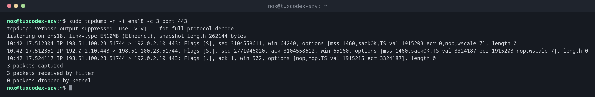

# tcpdump

> Records network packets on an interface and shows them line by line. The last resort when you need to know exactly what goes over the wire.



## Syntax

```bash
tcpdump [OPTION]... [FILTER]
```

Filters at the end of the command limit what is recorded, for example `port 443`, `host 198.51.100.23`, `tcp`, `icmp`, combined with `and`, `or` and `not`.

## Options

| Option | Description |
|--------|-------------|
| `-i DEV` | Interface to listen on, `any` for all |
| `-n` | Don't resolve names and ports, show numbers |
| `-c NUMBER` | Stop after `NUMBER` packets |
| `-w FILE` | Write the packets to a file (`.pcap`) for Wireshark |
| `-r FILE` | Read packets from a file |
| `-v`, `-vv` | More details per packet |
| `-A` | Show the content as text, e.g. for HTTP |

## Examples

**Watch a connection to the web server being established:**

```bash
sudo tcpdump -n -i ens18 -c 3 port 443
```

```text
tcpdump: verbose output suppressed, use -v[v]... for full protocol decode
listening on ens18, link-type EN10MB (Ethernet), snapshot length 262144 bytes
10:42:17.512304 IP 198.51.100.23.51744 > 192.0.2.10.443: Flags [S], seq 3104558611, win 64240, options [mss 1460,sackOK,TS val 1915203 ecr 0,nop,wscale 7], length 0
10:42:17.512351 IP 192.0.2.10.443 > 198.51.100.23.51744: Flags [S.], seq 2771046020, ack 3104558612, win 65160, options [mss 1460,sackOK,TS val 3324187 ecr 1915203,nop,wscale 7], length 0
10:42:17.524117 IP 198.51.100.23.51744 > 192.0.2.10.443: Flags [.], ack 1, win 502, options [nop,nop,TS val 1915215 ecr 3324187], length 0
3 packets captured
3 packets received by filter
0 packets dropped by kernel
```

| Flag | Meaning |
|------|---------|
| `[S]` | SYN: the client wants to connect |
| `[S.]` | SYN-ACK: the server accepts |
| `[.]` | ACK: the connection is established |
| `[P.]`, `[F.]`, `[R]` | Data, end of connection, reset |

**Watch DNS queries:**

```bash
sudo tcpdump -n -i ens18 -c 2 port 53
```

```text
tcpdump: verbose output suppressed, use -v[v]... for full protocol decode
listening on ens18, link-type EN10MB (Ethernet), snapshot length 262144 bytes
10:42:17.204118 IP 192.0.2.10.41322 > 192.0.2.53.53: 51234+ A? example.com. (29)
10:42:17.216502 IP 192.0.2.53.53 > 192.0.2.10.41322: 51234 1/0/0 A 198.51.100.7 (45)
2 packets captured
2 packets received by filter
0 packets dropped by kernel
```

The server asks `192.0.2.53` for the address of `example.com` and gets one answer.

**Find out whether connections are blocked:**

```bash
sudo tcpdump -n -i ens18 -c 3 port 5432
```

```text
tcpdump: verbose output suppressed, use -v[v]... for full protocol decode
listening on ens18, link-type EN10MB (Ethernet), snapshot length 262144 bytes
10:42:17.512304 IP 198.51.100.23.51750 > 192.0.2.10.5432: Flags [S], seq 1840221573, win 64240, options [mss 1460,sackOK,TS val 1915511 ecr 0,nop,wscale 7], length 0
10:42:18.536219 IP 198.51.100.23.51750 > 192.0.2.10.5432: Flags [S], seq 1840221573, win 64240, options [mss 1460,sackOK,TS val 1916535 ecr 0,nop,wscale 7], length 0
10:42:20.584207 IP 198.51.100.23.51750 > 192.0.2.10.5432: Flags [S], seq 1840221573, win 64240, options [mss 1460,sackOK,TS val 1918583 ecr 0,nop,wscale 7], length 0
3 packets captured
3 packets received by filter
0 packets dropped by kernel
```

The client sends SYN after SYN, but the server never answers: a firewall drops the
packets, or nothing listens. If nothing listens, the server would answer with `[R.]`.

**Record into a file for Wireshark:**

```bash
sudo tcpdump -n -i ens18 -w capture.pcap host 198.51.100.23 and not port 22
```

```text
tcpdump: listening on ens18, link-type EN10MB (Ethernet), snapshot length 262144 bytes
^C1284 packets captured
1291 packets received by filter
0 packets dropped by kernel
```

Stop the recording with ++ctrl+c++. Copy `capture.pcap` to your computer and open it in
Wireshark for a detailed analysis.

## When do I need it?

- When `ping`, `nc` and `curl` don't explain why a connection fails
- To prove whether packets arrive at the server at all, or are lost before
- To analyse DNS, mail or other protocol problems in detail

!!! tip "Exclude your own SSH session"
    Over SSH, `tcpdump` also records its own output travelling over SSH, which creates
    a flood. Add `and not port 22` to the filter.

!!! warning "Recordings contain sensitive data"
    Unencrypted traffic, such as HTTP, mail or database connections, is fully readable
    in the recording, including passwords. Protect and delete `.pcap` files after the
    analysis.

## Distribution differences

| | Debian | Ubuntu | RHEL | Arch |
|---|--------|--------|------|------|
| Installed by default | no, package `tcpdump` | yes | no, package `tcpdump` | no, package `tcpdump` |

## Related commands

[ss](ss.md) · [nc](nc.md) · [nft](nft.md) · [ping](ping.md)
