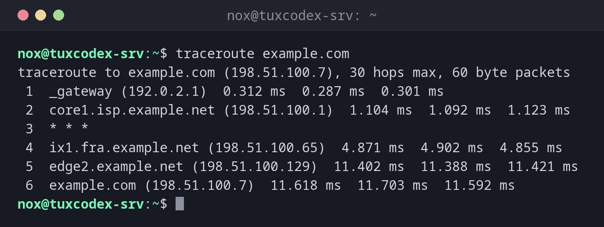

# traceroute

> Shows the way packets take to a host, router by router, and how long each step takes.



## Syntax

```bash
traceroute [OPTION]... HOST
```

## Options

| Option | Description |
|--------|-------------|
| `-n` | Don't resolve router names, only show addresses (faster) |
| `-m NUMBER` | Maximum number of hops, default `30` |
| `-q NUMBER` | Probes per hop, default `3` |
| `-T -p PORT` | Use TCP to this port instead of UDP, passes many firewalls |
| `-I` | Use ICMP like `ping` |
| `-4`, `-6` | Force IPv4 or IPv6 |

## Examples

**Show the way to a host:**

```bash
traceroute example.com
```

```text
traceroute to example.com (198.51.100.7), 30 hops max, 60 byte packets
 1  _gateway (192.0.2.1)  0.312 ms  0.287 ms  0.301 ms
 2  core1.isp.example.net (198.51.100.1)  1.104 ms  1.092 ms  1.123 ms
 3  * * *
 4  ix1.fra.example.net (198.51.100.65)  4.871 ms  4.902 ms  4.855 ms
 5  edge2.example.net (198.51.100.129)  11.402 ms  11.388 ms  11.421 ms
 6  example.com (198.51.100.7)  11.618 ms  11.703 ms  11.592 ms
```

Every line is one router. The three times are three probes. `* * *` means: this router
doesn't answer, which is normal as long as the following hops work.

**Faster, without name resolution:**

```bash
traceroute -n example.com
```

```text
traceroute to example.com (198.51.100.7), 30 hops max, 60 byte packets
 1  192.0.2.1  0.298 ms  0.276 ms  0.290 ms
 2  198.51.100.1  1.098 ms  1.101 ms  1.087 ms
 3  * * *
 4  198.51.100.65  4.866 ms  4.893 ms  4.849 ms
 5  198.51.100.129  11.395 ms  11.384 ms  11.410 ms
 6  198.51.100.7  11.602 ms  11.698 ms  11.587 ms
```

**Test the way to a web server through firewalls:**

```bash
sudo traceroute -T -p 443 example.com
```

```text
traceroute to example.com (198.51.100.7), 30 hops max, 60 byte packets
 1  _gateway (192.0.2.1)  0.305 ms  0.281 ms  0.296 ms
 2  core1.isp.example.net (198.51.100.1)  1.110 ms  1.097 ms  1.119 ms
 3  ix1.fra.example.net (198.51.100.65)  4.880 ms  4.871 ms  4.902 ms
 4  edge2.example.net (198.51.100.129)  11.398 ms  11.405 ms  11.391 ms
 5  example.com (198.51.100.7)  11.612 ms  11.701 ms  11.590 ms
```

**The way ends somewhere:**

```bash
traceroute -n -m 8 198.51.100.200
```

```text
traceroute to 198.51.100.200 (198.51.100.200), 8 hops max, 60 byte packets
 1  192.0.2.1  0.301 ms  0.284 ms  0.292 ms
 2  198.51.100.1  1.101 ms  1.096 ms  1.090 ms
 3  * * *
 4  * * *
 5  * * *
 6  * * *
 7  * * *
 8  * * *
```

From hop 3 on, nothing answers anymore: the packets are lost behind
`198.51.100.1`, for example at a firewall or a broken route.

## When do I need it?

- When a host is unreachable: up to which router do the packets get?
- When a connection is slow: at which hop does the time jump?
- To show your hosting provider or ISP where exactly a problem occurs

!!! tip "`mtr` for a longer measurement"
    `traceroute` shows a single snapshot. [`mtr`](mtr.md) repeats the measurement
    continuously and shows packet loss per hop.

!!! warning "Not installed by default"
    Install the package `traceroute` with the package manager of your distribution.
    `tracepath` does a similar job and is often already there, see the table below.

## Distribution differences

| | Debian | Ubuntu | RHEL | Arch |
|---|--------|--------|------|------|
| `traceroute` | package `traceroute` | package `traceroute` | package `traceroute` | package `traceroute` |
| `tracepath` | package `iputils-tracepath` | package `iputils-tracepath` | part of `iputils` | part of `iputils` |

## Related commands

[ping](ping.md) · [mtr](mtr.md) · [ip](ip.md)
