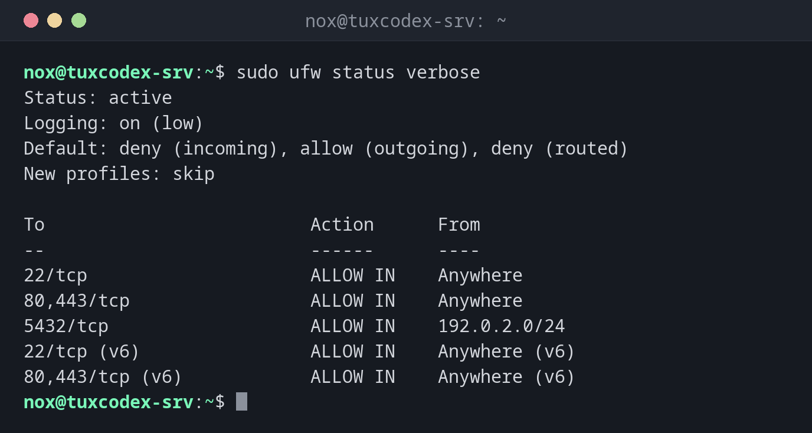

# ufw

> The uncomplicated firewall of Debian and Ubuntu: allows and blocks ports with short, readable rules, without having to write `nftables` rules by hand.



## Syntax

```bash
ufw [OPTION]... COMMAND
```

## Options

| Command | Description |
|---------|-------------|
| `status verbose` | State, default policies and all rules |
| `status numbered` | Rules with numbers, for deleting |
| `allow PORT[/PROTO]` | Allow incoming connections on a port |
| `allow from NET to any port PORT` | Allow a port only from certain addresses |
| `deny`, `reject` | Block silently, or with an answer |
| `limit PORT/tcp` | Allow, but block addresses with too many connection attempts |
| `delete NUMBER` | Delete a rule |
| `enable`, `disable` | Switch the firewall on or off, also at boot |

## Examples

**Show the state and all rules:**

```bash
sudo ufw status verbose
```

```text
Status: active
Logging: on (low)
Default: deny (incoming), allow (outgoing), deny (routed)
New profiles: skip

To                         Action      From
--                         ------      ----
22/tcp                     ALLOW IN    Anywhere
80,443/tcp                 ALLOW IN    Anywhere
5432/tcp                   ALLOW IN    192.0.2.0/24
22/tcp (v6)                ALLOW IN    Anywhere (v6)
80,443/tcp (v6)            ALLOW IN    Anywhere (v6)
```

`Default: deny (incoming)` means: everything that isn't allowed explicitly is blocked.

**Allow SSH before switching the firewall on:**

```bash
sudo ufw allow 22/tcp
```

```text
Rules updated
Rules updated (v6)
```

Without an SSH rule, `enable` would lock you out of the server.

**Switch the firewall on:**

```bash
sudo ufw enable
```

```text
Command may disrupt existing ssh connections. Proceed with operation (y|n)? y
Firewall is active and enabled on system startup
```

**Allow the database only from the own network:**

```bash
sudo ufw allow from 192.0.2.0/24 to any port 5432 proto tcp
```

```text
Rule added
```

**Delete a rule by its number:**

```bash
sudo ufw status numbered
sudo ufw delete 3
```

```text
Status: active

     To                         Action      From
     --                         ------      ----
[ 1] 22/tcp                     ALLOW IN    Anywhere
[ 2] 80,443/tcp                 ALLOW IN    Anywhere
[ 3] 5432/tcp                   ALLOW IN    192.0.2.0/24
[ 4] 22/tcp (v6)                ALLOW IN    Anywhere (v6)
[ 5] 80,443/tcp (v6)            ALLOW IN    Anywhere (v6)

Deleting:
 allow from 192.0.2.0/24 to any port 5432 proto tcp
Proceed with operation (y|n)? y
Rule deleted
```

`ufw` deletes the IPv4 and the IPv6 rule of a pair separately. Check the numbers again
after every delete, they shift.

## When do I need it?

- On every Debian or Ubuntu server that is reachable from the internet
- To open a port for a new service, such as a web server
- To make a database or an admin interface reachable only from certain networks

!!! tip "Rate limit for SSH"
    `sudo ufw limit 22/tcp` blocks addresses that try to connect more than six times in
    30 seconds. This slows down brute force attacks on SSH considerably.

!!! danger "Allow SSH first"
    Always run `sudo ufw allow 22/tcp` (or your SSH port) before `ufw enable`. Otherwise
    the firewall blocks your own session as soon as it reconnects.

## Distribution differences

| | Debian | Ubuntu | RHEL | Arch |
|---|--------|--------|------|------|
| Firewall tool | `ufw` (package `ufw`) | `ufw`, installed but inactive | `firewall-cmd` | `ufw` or `nft` |

## Related commands

[ss](ss.md) · [nc](nc.md)
