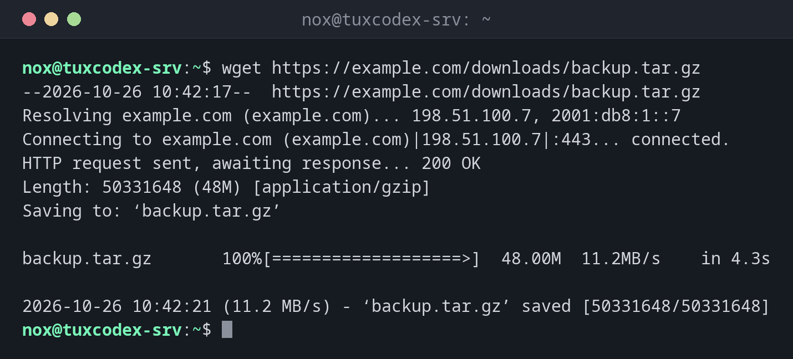

# wget

> Lädt Dateien von Web- und FTP-Servern herunter. Setzt abgebrochene Downloads fort und kann ganze Verzeichnisse spiegeln.



## Syntax

```bash
wget [OPTION]... URL...
```

## Optionen

| Option | Beschreibung |
|--------|--------------|
| `-O DATEI` | Unter diesem Namen speichern (`-O -` schreibt auf die Standardausgabe) |
| `-c` | Einen abgebrochenen Download fortsetzen |
| `-q` | Still, keine Ausgabe |
| `-P VERZEICHNIS` | In dieses Verzeichnis speichern |
| `--spider` | Nur prüfen, ob die Datei existiert, nicht herunterladen |
| `-i DATEI` | Alle URLs herunterladen, die in `DATEI` stehen |
| `-r`, `-np` | Rekursiv herunterladen, aber nicht über das Startverzeichnis hinaus |
| `--limit-rate=RATE` | Die Bandbreite begrenzen, z. B. `5m` |

## Beispiele

**Eine Datei herunterladen:**

```bash
wget https://example.com/downloads/backup.tar.gz
```

```text
--2026-10-26 10:42:17--  https://example.com/downloads/backup.tar.gz
Resolving example.com (example.com)... 198.51.100.7, 2001:db8:1::7
Connecting to example.com (example.com)|198.51.100.7|:443... connected.
HTTP request sent, awaiting response... 200 OK
Length: 50331648 (48M) [application/gzip]
Saving to: ‘backup.tar.gz’

backup.tar.gz       100%[===================>]  48.00M  11.2MB/s    in 4.3s

2026-10-26 10:42:21 (11.2 MB/s) - ‘backup.tar.gz’ saved [50331648/50331648]
```

**Einen abgebrochenen Download fortsetzen:**

```bash
wget -c https://example.com/downloads/backup.tar.gz
```

```text
--2026-10-26 10:45:03--  https://example.com/downloads/backup.tar.gz
Resolving example.com (example.com)... 198.51.100.7, 2001:db8:1::7
Connecting to example.com (example.com)|198.51.100.7|:443... connected.
HTTP request sent, awaiting response... 206 Partial Content
Length: 50331648 (48M), 29360128 (28M) remaining [application/gzip]
Saving to: ‘backup.tar.gz’

backup.tar.gz       100%[++++++++++=========>]  48.00M  11.4MB/s    in 2.5s

2026-10-26 10:45:06 (11.4 MB/s) - ‘backup.tar.gz’ saved [50331648/50331648]
```

`206 Partial Content`: Der Server schickt nur den fehlenden Teil. Die `+`-Zeichen im
Balken markieren den Teil, der schon da war.

**Unter anderem Namen in ein anderes Verzeichnis speichern:**

```bash
wget -q -O /srv/backup/latest.tar.gz https://example.com/downloads/backup.tar.gz && ls -lh /srv/backup/latest.tar.gz
```

```text
-rw-r--r-- 1 nox nox 48M Oct 26 10:42 /srv/backup/latest.tar.gz
```

**Prüfen, ob eine Datei existiert:**

```bash
wget --spider https://example.com/downloads/backup.tar.gz
```

```text
Spider mode enabled. Check if remote file exists.
--2026-10-26 10:42:17--  https://example.com/downloads/backup.tar.gz
Resolving example.com (example.com)... 198.51.100.7, 2001:db8:1::7
Connecting to example.com (example.com)|198.51.100.7|:443... connected.
HTTP request sent, awaiting response... 200 OK
Length: 50331648 (48M) [application/gzip]
Remote file exists.
```

**Eine Datei, die es nicht gibt:**

```bash
wget https://example.com/downloads/old-backup.tar.gz
```

```text
--2026-10-26 10:42:17--  https://example.com/downloads/old-backup.tar.gz
Resolving example.com (example.com)... 198.51.100.7, 2001:db8:1::7
Connecting to example.com (example.com)|198.51.100.7|:443... connected.
HTTP request sent, awaiting response... 404 Not Found
2026-10-26 10:42:17 ERROR 404: Not Found.
```

`wget` endet bei Serverfehlern wie diesem mit Exit-Code `8`, damit Skripte darauf reagieren
können.

## Wann brauche ich das?

- Um ein Release, ein Backup oder ein Installationsskript auf den Server zu laden
- Für große Downloads über eine instabile Verbindung, dank `-c`
- In Skripten, die regelmäßig Dateien holen

!!! tip "`curl` oder `wget`?"
    `wget` ist zum Herunterladen von Dateien gemacht, mit Fortschrittsbalken, Fortsetzen
    und Rekursion. Zum Testen von Webseiten und APIs ist [`curl`](curl.md) das bessere
    Werkzeug.

!!! warning "Heruntergeladene Skripte vor dem Ausführen prüfen"
    `wget -O - https://… | sudo bash` führt Code aus dem Internet als root aus, ohne dass
    du ihn siehst. Lade das Skript erst herunter, lies es und führe es dann aus.

## Unterschiede zwischen Distributionen

| | Debian | Ubuntu | RHEL | Arch |
|---|--------|--------|------|------|
| Vorinstalliert | mit den Standard-Systemwerkzeugen | ja | nein, `sudo dnf install wget` | nein, `sudo pacman -S wget` |

## Verwandte Befehle

[curl](curl.md)
