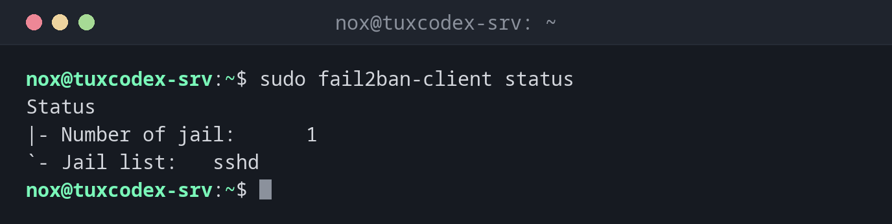

# fail2ban-client

> Steuert fail2ban, das die Logs nach fehlgeschlagenen Anmeldungen durchsucht und die IP-Adressen der Angreifer eine Zeit lang in der Firewall sperrt.



## Syntax

```bash
fail2ban-client BEFEHL [ARGUMENT]...
```

Deine Einstellungen gehören in `/etc/fail2ban/jail.local`, nie in `jail.conf`, das Paketupdates überschreiben.

## Optionen

| Befehl | Beschreibung |
|--------|--------------|
| `status` | Laufende Jails (überwachte Dienste) |
| `status JAIL` | Fehlversuche und gesperrte Adressen eines Jails |
| `set JAIL banip IP` | Eine Adresse von Hand sperren |
| `set JAIL unbanip IP` | Eine Sperre aufheben |
| `banned` | Alle gesperrten Adressen aller Jails |
| `reload` | Die Konfiguration neu einlesen |
| `ping` | Prüfen, ob der fail2ban-Server läuft |

## Beispiele

**Die laufenden Jails anzeigen:**

```bash
sudo fail2ban-client status
```

```text
Status
|- Number of jail:      1
`- Jail list:   sshd
```

**Den Zustand des SSH-Jails anzeigen:**

```bash
sudo fail2ban-client status sshd
```

```text
Status for the jail: sshd
|- Filter
|  |- Currently failed: 3
|  |- Total failed:     412
|  `- Journal matches:  _SYSTEMD_UNIT=ssh.service + _COMM=sshd
`- Actions
   |- Currently banned: 2
   |- Total banned:     37
   `- Banned IP list:   198.51.100.66 198.51.100.81
```

Bisher 412 fehlgeschlagene Anmeldungen, 37 Sperren, zwei Adressen sind gerade gesperrt.

**Eine Sperre aufheben, etwa für einen Kollegen, der sich vertippt hat:**

```bash
sudo fail2ban-client set sshd unbanip 198.51.100.66
```

```text
1
```

`1` heißt: Eine Adresse wurde entsperrt.

**Eine Adresse von Hand sperren:**

```bash
sudo fail2ban-client set sshd banip 198.51.100.99
```

```text
1
```

**Eine einfache Konfiguration:**

```bash
cat /etc/fail2ban/jail.local
```

```text
[DEFAULT]
bantime  = 1h
findtime = 10m
maxretry = 5
ignoreip = 127.0.0.1/8 ::1 192.0.2.45

[sshd]
enabled = true
```

`ignoreip` enthält Adressen, die nie gesperrt werden, etwa dein eigenes Büro. Nach einer
Änderung führst du `sudo fail2ban-client reload` aus.

## Wann brauche ich das?

- Auf jedem Server mit SSH, der aus dem Internet erreichbar ist, gegen Brute-Force-Angriffe
- Wenn ein Benutzer ausgesperrt ist, nachdem er das Passwort mehrmals falsch eingegeben hat
- Um zu sehen, wie viele Angriffe auf den Server treffen

!!! tip "Mit Schlüsseln wird fail2ban weniger wichtig"
    Mit `PasswordAuthentication no` in [`sshd`](sshd.md) kann Passwortraten gar nicht
    gelingen. fail2ban hält dann vor allem die Logs sauber und spart Ressourcen.

!!! warning "Sperr dich nicht selbst aus"
    Trag deine eigene feste IP-Adresse in `ignoreip` ein. Sonst reichen ein paar Tippfehler,
    und fail2ban sperrt dich für die Dauer von `bantime`.

## Unterschiede zwischen Distributionen

| | Debian | Ubuntu | RHEL | Arch |
|---|--------|--------|------|------|
| Paket | `fail2ban`, SSH-Jail nach der Installation aktiv | `fail2ban` | `fail2ban` aus EPEL | `fail2ban` |
| Logs gelesen aus | Journal | Journal oder `/var/log/auth.log` | Journal oder `/var/log/secure` | Journal |

## Verwandte Befehle

[sshd](sshd.md) · [journalctl](../09-systemd/journalctl.md) · [nft](../11-network/nft.md)
