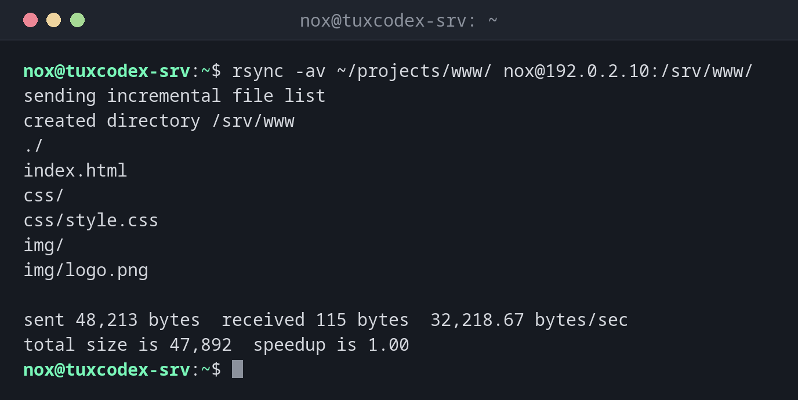

# rsync

> Gleicht Dateien und Verzeichnisse ab, lokal oder über SSH. Überträgt nur, was sich geändert hat, und ist damit das Standardwerkzeug für Backups und Deployments.



## Syntax

```bash
rsync [OPTION]... QUELLE... ZIEL
```

Der abschließende Schrägstrich ist wichtig: `/srv/www/` kopiert den **Inhalt** des Verzeichnisses, `/srv/www` das Verzeichnis **selbst** ins Ziel.

## Optionen

| Option | Beschreibung |
|--------|--------------|
| `-a` | Archivmodus: rekursiv, behält Rechte, Zeiten, Besitzer und Links |
| `-v` | Die übertragenen Dateien auflisten |
| `-z` | Während der Übertragung komprimieren |
| `-n`, `--dry-run` | Nur zeigen, was passieren würde |
| `--delete` | Dateien im Ziel löschen, die es in der Quelle nicht mehr gibt |
| `--progress` | Den Fortschritt pro Datei zeigen |
| `--exclude=MUSTER` | Dateien und Verzeichnisse überspringen, die zu `MUSTER` passen |
| `-e "ssh -p 2222"` | SSH mit besonderen Optionen nutzen |

## Beispiele

**Eine Webseite auf den Server kopieren:**

```bash
rsync -av ~/projects/www/ nox@192.0.2.10:/srv/www/
```

```text
sending incremental file list
created directory /srv/www
./
index.html
css/
css/style.css
img/
img/logo.png

sent 48,213 bytes  received 115 bytes  32,218.67 bytes/sec
total size is 47,892  speedup is 1.00
```

**Nach einer Änderung erneut ausführen:**

```bash
rsync -av ~/projects/www/ nox@192.0.2.10:/srv/www/
```

```text
sending incremental file list
index.html

sent 7,102 bytes  received 41 bytes  14,286.00 bytes/sec
total size is 47,903  speedup is 6.71
```

Nur `index.html` hat sich geändert, also wird nur sie übertragen. Das ist die Stärke von
`rsync`.

**Prüfen, was `--delete` entfernen würde:**

```bash
rsync -av --delete --dry-run ~/projects/www/ nox@192.0.2.10:/srv/www/
```

```text
sending incremental file list
deleting old/banner.png
index.html

sent 218 bytes  received 30 bytes  496.00 bytes/sec
total size is 47,903  speedup is 193.16 (DRY RUN)
```

`old/banner.png` gibt es lokal nicht mehr und würde auf dem Server gelöscht. Ohne
`--dry-run` passiert das wirklich.

**Eine große Datei mit Fortschritt kopieren:**

```bash
rsync -a --progress db.sql.gz nox@192.0.2.10:/srv/backup/
```

```text
sending incremental file list
db.sql.gz
     30,000,000 100%   11.20MB/s    0:00:02 (xfr#1, to-chk=0/1)

sent 30,007,421 bytes  received 35 bytes  8,573,559.14 bytes/sec
total size is 30,000,000  speedup is 1.00
```

**Ein Backup vom Server holen, ohne das Cache-Verzeichnis:**

```bash
rsync -av --exclude=cache/ nox@192.0.2.10:/srv/app/ ~/backup/app/
```

```text
receiving incremental file list
./
config.php
data/
data/users.json

sent 69 bytes  received 18,442 bytes  37,022.00 bytes/sec
total size is 18,201  speedup is 0.98
```

## Wann brauche ich das?

- Für Backups auf einen anderen Server, regelmäßig per Cron oder systemd-Timer
- Um eine Webseite oder Anwendung auf einen Server zu bringen
- Um große Datenmengen zu verschieben, weil sich eine abgebrochene Übertragung einfach
  neu starten lässt

!!! tip "`--delete` immer erst mit `--dry-run` testen"
    Ein falscher Pfad oder ein fehlender Schrägstrich mit `--delete` kann das ganze
    Zielverzeichnis löschen. Schau dir den Probelauf an, dann führe den echten Befehl aus.

!!! warning "Auf beiden Seiten installiert"
    `rsync` muss auf deinem Rechner und auf dem Server installiert sein. Sonst bekommst du
    von der Gegenseite `rsync: command not found`.

## Unterschiede zwischen Distributionen

| | Debian | Ubuntu | RHEL | Arch |
|---|--------|--------|------|------|
| Vorinstalliert | nein | ja | nein | nein |

## Verwandte Befehle

[scp](scp.md) · [ssh](ssh.md) · [cp](../03-files/cp.md)
