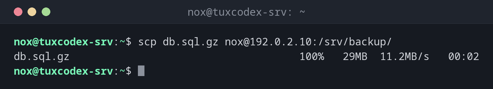

# scp

> Kopiert Dateien und Verzeichnisse über SSH, zwischen deinem Rechner und einem Server oder zwischen zwei Servern.



## Syntax

```bash
scp [OPTION]... QUELLE... ZIEL
```

Ein entfernter Pfad hat die Form `BENUTZER@HOST:PFAD`. Ohne führendes `/` ist der Pfad relativ zum Home-Verzeichnis auf dem Server.

## Optionen

| Option | Beschreibung |
|--------|--------------|
| `-r` | Verzeichnisse rekursiv kopieren |
| `-P PORT` | SSH-Port des Servers (großes `P`) |
| `-p` | Änderungszeiten und Rechte beibehalten |
| `-i DATEI` | Diesen privaten Schlüssel nutzen |
| `-l LIMIT` | Die Bandbreite in Kbit/s begrenzen |
| `-3` | Zwischen zwei Servern über deinen Rechner kopieren |

## Beispiele

**Eine Datei auf den Server kopieren:**

```bash
scp db.sql.gz nox@192.0.2.10:/srv/backup/
```

```text
db.sql.gz                                     100%   29MB  11.2MB/s   00:02
```

**Eine Datei vom Server holen:**

```bash
scp nox@192.0.2.10:/var/log/nginx/error.log .
```

```text
error.log                                     100%   84KB   1.9MB/s   00:00
```

`.` am Ende heißt: ins aktuelle Verzeichnis.

**Ein ganzes Verzeichnis kopieren:**

```bash
scp -r ~/srv/www nox@192.0.2.10:/tmp/
```

```text
file1.bin                                     100%  195KB   8.1MB/s   00:00
file2.bin                                     100%  195KB   8.4MB/s   00:00
file3.bin                                     100%  195KB   8.3MB/s   00:00
index.html                                    100% 6512     1.1MB/s   00:00
```

**Einen anderen SSH-Port nutzen:**

```bash
scp -P 2222 config.tar.gz nox@192.0.2.20:
```

```text
config.tar.gz                                 100%   12KB   2.0MB/s   00:00
```

## Wann brauche ich das?

- Um schnell eine einzelne Datei auf einen Server oder von dort zu kopieren
- Um ein Backup oder eine Logdatei zur Analyse zu holen
- Wenn `rsync` auf dem Server nicht installiert ist

!!! tip "`rsync` für größere Aufgaben"
    `scp` kopiert immer alles neu und kann eine abgebrochene Übertragung nicht fortsetzen.
    Für Verzeichnisse und große Dateien ist [`rsync`](rsync.md) schneller und robuster.

!!! warning "Leerzeichen und Sonderzeichen in entfernten Pfaden"
    Entfernte Pfade wertet die Shell auf dem Server aus. Setze Pfade mit Leerzeichen doppelt
    in Anführungszeichen: `scp nox@192.0.2.10:"'/srv/old backup.tar.gz'" .`

## Verwandte Befehle

[rsync](rsync.md) · [sftp](sftp.md) · [ssh](ssh.md) · [cp](../03-files/cp.md) · [sftp](sftp.md)
