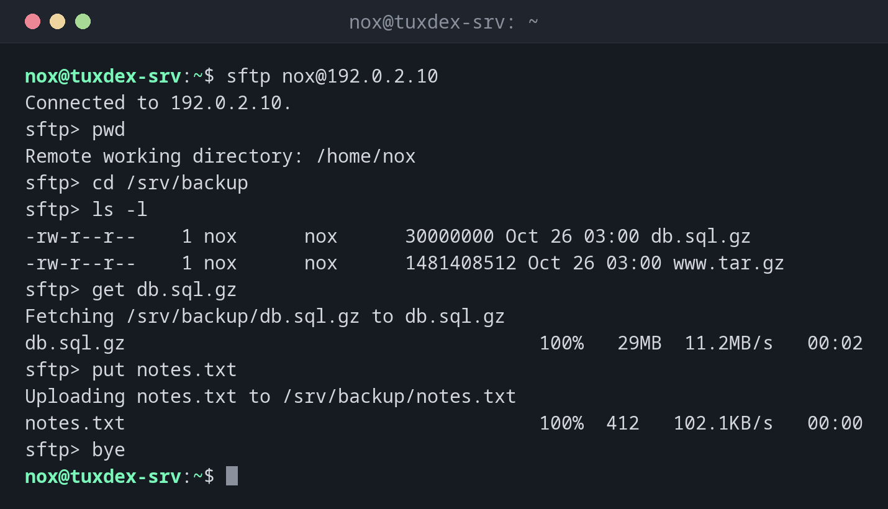

# sftp

> An interactive file transfer over SSH, similar to FTP: browse directories on the server, fetch and upload files.



## Syntax

```bash
sftp [OPTION]... [USER@]HOST[:PATH]
```

Options when starting: `-P PORT` for a different port, `-b FILE` for a batch file with commands.

## Options

| Command in `sftp` | Description |
|------------------|-------------|
| `ls`, `cd`, `pwd` | List, change and show the directory on the server |
| `lls`, `lcd`, `lpwd` | The same on your own computer |
| `get FILE` | Download a file (`get -r` for directories) |
| `put FILE` | Upload a file (`put -r` for directories) |
| `mkdir`, `rm`, `rename` | Create, delete and rename on the server |
| `bye` | End the session |

## Examples

**Open a session and transfer files:**

```bash
sftp nox@192.0.2.10
```

```text
Connected to 192.0.2.10.
sftp> pwd
Remote working directory: /home/nox
sftp> cd /srv/backup
sftp> ls -l
-rw-r--r--    1 nox      nox      30000000 Oct 26 03:00 db.sql.gz
-rw-r--r--    1 nox      nox      1481408512 Oct 26 03:00 www.tar.gz
sftp> get db.sql.gz
Fetching /srv/backup/db.sql.gz to db.sql.gz
db.sql.gz                                     100%   29MB  11.2MB/s   00:02
sftp> put notes.txt
Uploading notes.txt to /srv/backup/notes.txt
notes.txt                                     100%  412   102.1KB/s   00:00
sftp> bye
```

Commands with an `l` in front work on your own computer: `lls` lists the local directory.

**Fetch a single file directly:**

```bash
sftp nox@192.0.2.10:/srv/backup/db.sql.gz
```

```text
Connected to 192.0.2.10.
Fetching /srv/backup/db.sql.gz to db.sql.gz
db.sql.gz                                     100%   29MB  11.2MB/s   00:02
```

**The batch file:**

```bash
cat transfer.txt
```

```text
cd /srv/backup
get db.sql.gz
put notes.txt
```

**Run prepared commands from a file:**

```bash
sftp -b transfer.txt nox@192.0.2.10
```

```text
sftp> cd /srv/backup
sftp> get db.sql.gz
Fetching /srv/backup/db.sql.gz to db.sql.gz
sftp> put notes.txt
Uploading notes.txt to /srv/backup/notes.txt
```

## When do I need it?

- When you want to look around on the server before copying files
- For users who may only transfer files but not log in (SFTP only accounts)
- With graphical clients like FileZilla or WinSCP, which use the same protocol

!!! tip "SFTP only users"
    With `ForceCommand internal-sftp` and `ChrootDirectory` in `sshd_config`, you can give
    users access to a single directory only, without a shell. Ideal for customers who
    upload files.

!!! warning "Not FTP"
    Despite the name, SFTP has nothing to do with FTP or FTPS. It runs over SSH on port 22
    and uses the same users and keys.

## Related commands

[scp](scp.md) · [rsync](rsync.md) · [sshd](sshd.md) · [rsync](rsync.md) · [sshd](sshd.md)
