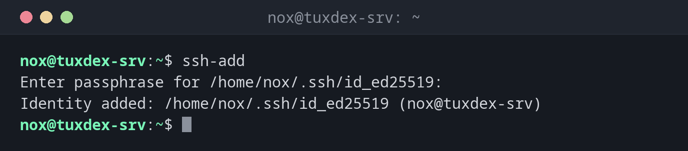

# ssh-add

> Loads SSH keys into the running `ssh-agent`, lists the loaded keys and removes them again.



## Syntax

```bash
ssh-add [OPTION]... [FILE]...
```

## Options

| Option | Description |
|--------|-------------|
| *(none)* | Add the default keys (`~/.ssh/id_ed25519` and others) |
| `FILE` | Add this key |
| `-l` | List the fingerprints of the loaded keys |
| `-L` | List the loaded public keys in full |
| `-t TIME` | Remove the key automatically after `TIME`, e.g. `1h` |
| `-d FILE` | Remove a single key |
| `-D` | Remove all keys |

## Examples

**Add the default key:**

```bash
ssh-add
```

```text
Enter passphrase for /home/nox/.ssh/id_ed25519:
Identity added: /home/nox/.ssh/id_ed25519 (nox@tuxdex-srv)
```

From now on, `ssh` uses the key without asking for the passphrase again.

**Add a key only for one hour:**

```bash
ssh-add -t 1h
```

```text
Enter passphrase for /home/nox/.ssh/id_ed25519:
Identity added: /home/nox/.ssh/id_ed25519 (nox@tuxdex-srv)
Lifetime set to 3600 seconds
```

**Show the loaded keys:**

```bash
ssh-add -l
```

```text
256 SHA256:MH9iiNBiK1fYLz4X57tGWkD2uYd7TpgABke1SUynK1k nox@tuxdex-srv (ED25519)
```

**Show the public key of a loaded key:**

```bash
ssh-add -L
```

```text
ssh-ed25519 AAAAC3NzaC1lZDI1NTE5AAAAIAWZDtTcIe235G0EzeAQj/BESDJnWT39gRghXyiMZZal nox@tuxdex-srv
```

**Remove a key:**

```bash
ssh-add -d ~/.ssh/id_ed25519
```

```text
Identity removed: /home/nox/.ssh/id_ed25519 ED25519 (nox@tuxdex-srv)
```

**The agent is empty:**

```bash
ssh-add -l
```

```text
The agent has no identities.
```

## When do I need it?

- At the start of a working session, to unlock your key once
- To check which key the agent offers when a login fails
- Before a break, to remove all keys from the agent with `-D`

!!! tip "Load keys automatically"
    With `AddKeysToAgent yes` in `~/.ssh/config`, `ssh` adds the key to the agent the
    first time you use it. You don't need to run `ssh-add` by hand.

!!! warning "Too many keys"
    The agent offers every loaded key one after the other. Servers often allow only six
    attempts, so with many keys you can see `Too many authentication failures`. Use
    `IdentitiesOnly yes` and `IdentityFile` in `~/.ssh/config` per host.

## Related commands

[ssh-agent](ssh-agent.md) · [ssh-keygen](ssh-keygen.md) · [ssh](ssh.md)
