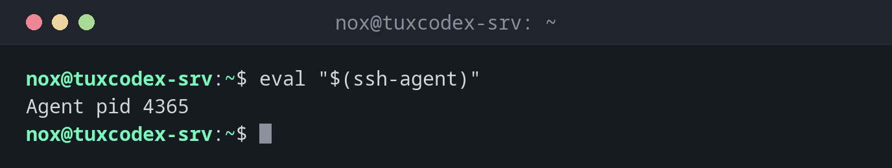

# ssh-agent

> Hält deine entsperrten SSH-Schlüssel im Speicher, damit du die Passphrase nur einmal pro Sitzung eingibst statt bei jeder Verbindung.



## Syntax

```bash
ssh-agent [OPTION]...
```

Meist startest du ihn mit `eval "$(ssh-agent)"`, damit deine Shell seine Variablen bekommt. Der Agent lädt selbst keine Schlüssel. Du fügst sie mit [`ssh-add`](ssh-add.md) hinzu.

## Optionen

| Option | Beschreibung |
|--------|--------------|
| *(keine)* | Einen Agenten starten und die Variablen ausgeben, die deine Shell braucht |
| `-k` | Den laufenden Agenten beenden |
| `-t ZEIT` | Standard-Lebensdauer für hinzugefügte Schlüssel, z. B. `1h` |
| `-s`, `-c` | Die Variablen für `sh`/`bash` oder für `csh` ausgeben |

## Beispiele

**Einen Agenten in der aktuellen Shell starten:**

```bash
eval "$(ssh-agent)"
```

```text
Agent pid 4365
```

`eval` setzt die Variablen `SSH_AUTH_SOCK` und `SSH_AGENT_PID` in deiner Shell. Jedes
`ssh`, das du daraus startest, findet den Agenten darüber.

**Ansehen, was `ssh-agent` ohne `eval` ausgibt:**

```bash
ssh-agent
```

```text
SSH_AUTH_SOCK=/tmp/ssh-pDL3fcapSHNe/agent.4364; export SSH_AUTH_SOCK;
SSH_AGENT_PID=4365; export SSH_AGENT_PID;
echo Agent pid 4365;
```

Das sind Shell-Befehle. Ohne `eval` werden sie nur ausgegeben, und der Agent ist nicht
auffindbar.

**Es läuft kein Agent:**

```bash
ssh-add -l
```

```text
Could not open a connection to your authentication agent.
```

`SSH_AUTH_SOCK` ist in dieser Shell nicht gesetzt. Starte erst einen Agenten.

**Den Agenten beenden, wenn du fertig bist:**

```bash
eval "$(ssh-agent -k)"
```

```text
Agent pid 4365 killed
```

## Wann brauche ich das?

- Wenn du mit passphrasegeschützten Schlüsseln arbeitest und dich mit vielen Servern
  verbindest
- In Skripten, die mehrere SSH-Verbindungen hintereinander brauchen
- Auf Servern, auf denen du deinen Schlüssel für weitere Verbindungen brauchst, per
  Agent-Forwarding

!!! tip "Desktop-Systeme starten ihn für dich"
    Die meisten Desktop-Umgebungen und macOS starten beim Anmelden einen Agenten. Prüfe mit
    `echo $SSH_AUTH_SOCK`: Zeigt es einen Pfad, läuft schon ein Agent.

!!! warning "Agent-Forwarding nur zu vertrauenswürdigen Servern"
    Mit `ssh -A` kann der Server deinen Agenten nutzen, solange du verbunden bist. Ein
    root-Benutzer auf diesem Server könnte sich dann mit deinem Schlüssel an anderen
    Servern anmelden. Nimm für Sprungserver lieber `ssh -J`.

## Verwandte Befehle

[ssh-add](ssh-add.md) · [ssh](ssh.md) · [ssh-keygen](ssh-keygen.md)
