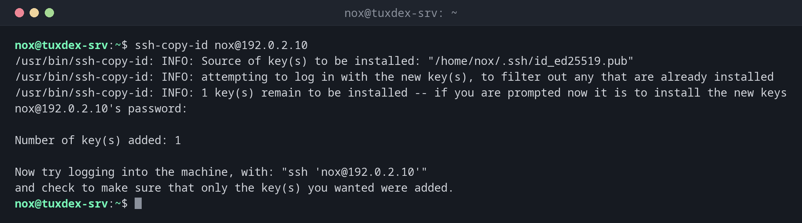

# ssh-copy-id

> Kopiert deinen öffentlichen SSH-Schlüssel auf einem Server nach `~/.ssh/authorized_keys`, damit du dich mit dem Schlüssel statt mit einem Passwort anmelden kannst.



## Syntax

```bash
ssh-copy-id [OPTION]... [BENUTZER@]HOST
```

## Optionen

| Option | Beschreibung |
|--------|--------------|
| `-i DATEI` | Diesen öffentlichen Schlüssel statt des Standards kopieren |
| `-p PORT` | SSH-Port des Servers |
| `-n` | Probelauf: nur zeigen, welche Schlüssel kopiert würden |
| `-f` | Auch kopieren, wenn der Schlüssel scheinbar schon da ist |

## Beispiele

**Den Schlüssel auf einen Server kopieren:**

```bash
ssh-copy-id nox@192.0.2.10
```

```text
/usr/bin/ssh-copy-id: INFO: Source of key(s) to be installed: "/home/nox/.ssh/id_ed25519.pub"
/usr/bin/ssh-copy-id: INFO: attempting to log in with the new key(s), to filter out any that are already installed
/usr/bin/ssh-copy-id: INFO: 1 key(s) remain to be installed -- if you are prompted now it is to install the new keys
nox@192.0.2.10's password:

Number of key(s) added: 1

Now try logging into the machine, with: "ssh 'nox@192.0.2.10'"
and check to make sure that only the key(s) you wanted were added.
```

Du gibst das Passwort ein letztes Mal ein. Danach klappt die Anmeldung mit dem Schlüssel.

**Die Anmeldung mit dem Schlüssel testen:**

```bash
ssh nox@192.0.2.10 hostname
```

```text
Enter passphrase for key '/home/nox/.ssh/id_ed25519':
tuxdex-srv
```

**Der Schlüssel ist schon auf dem Server:**

```bash
ssh-copy-id nox@192.0.2.10
```

```text
/usr/bin/ssh-copy-id: INFO: Source of key(s) to be installed: "/home/nox/.ssh/id_ed25519.pub"
/usr/bin/ssh-copy-id: INFO: attempting to log in with the new key(s), to filter out any that are already installed

/usr/bin/ssh-copy-id: WARNING: All keys were skipped because they already exist on the remote system.
                (if you think this is a mistake, you may want to use -f option)
```

**Nur zeigen, was kopiert würde:**

```bash
ssh-copy-id -n nox@192.0.2.10
```

```text
/usr/bin/ssh-copy-id: INFO: Source of key(s) to be installed: "/home/nox/.ssh/id_ed25519.pub"
=-=-=-=-=-=-=-=
Would have added the following key(s):

ssh-ed25519 AAAAC3NzaC1lZDI1NTE5AAAAIAWZDtTcIe235G0EzeAQj/BESDJnWT39gRghXyiMZZal nox@tuxdex-srv
=-=-=-=-=-=-=-=
```

**Prüfen, was auf dem Server liegt:**

```bash
ssh nox@192.0.2.10 cat .ssh/authorized_keys
```

```text
ssh-ed25519 AAAAC3NzaC1lZDI1NTE5AAAAIAWZDtTcIe235G0EzeAQj/BESDJnWT39gRghXyiMZZal nox@tuxdex-srv
```

## Wann brauche ich das?

- Nach dem Erzeugen eines Schlüssels, um ihn auf jeden Server zu bringen
- Wenn du Zugang zu einem neuen Server bekommst, der noch Passwort-Anmeldung nutzt
- Bevor du auf dem Server die Passwort-Anmeldung abschaltest

!!! tip "Ohne `ssh-copy-id`"
    Gibt es `ssh-copy-id` nicht, etwa unter Windows, nimm
    `cat ~/.ssh/id_ed25519.pub | ssh nox@192.0.2.10 "mkdir -p ~/.ssh && cat >> ~/.ssh/authorized_keys"`.

!!! warning "Nur den öffentlichen Schlüssel kopieren"
    `ssh-copy-id` kopiert nur `.pub`-Dateien. Kopiere nie den privaten Schlüssel auf einen
    Server. Er gehört nur auf den Rechner, von dem aus du arbeitest.

## Verwandte Befehle

[ssh-keygen](ssh-keygen.md) · [ssh](ssh.md) · [sshd](sshd.md)
