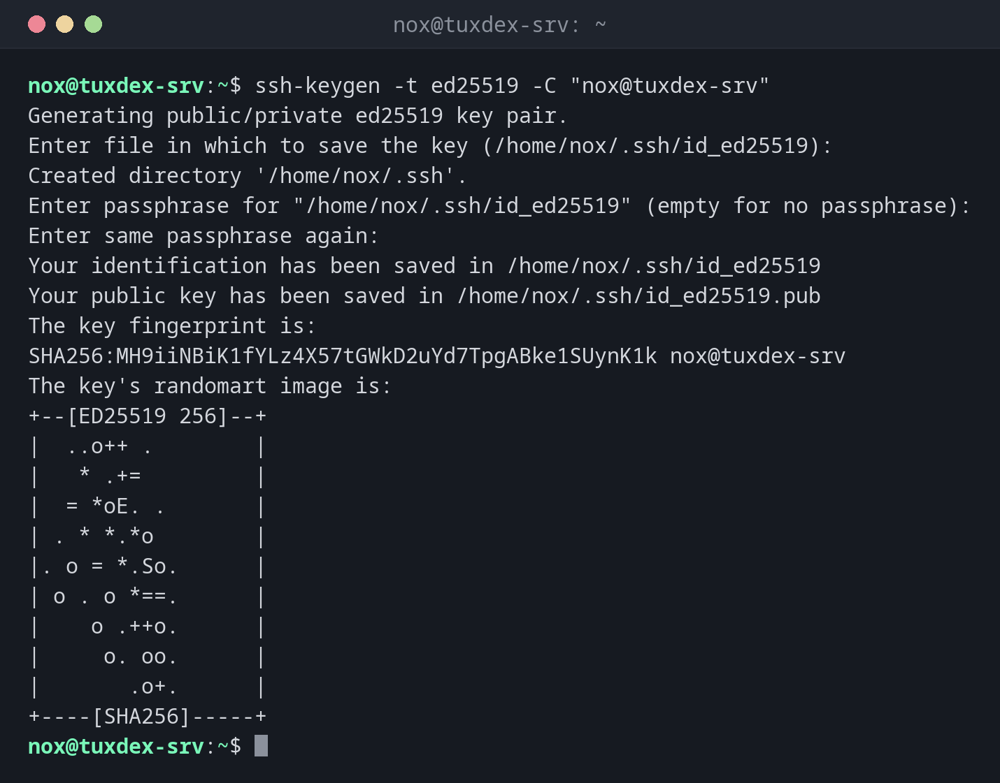

# ssh-keygen

> Creates and manages SSH keys: new key pairs, passphrases, fingerprints and entries in `known_hosts`.



## Syntax

```bash
ssh-keygen [OPTION]...
```

## Options

| Option | Description |
|--------|-------------|
| `-t TYPE` | Key type, `ed25519` is recommended |
| `-C COMMENT` | Comment at the end of the public key, usually `user@host` |
| `-f FILE` | File name of the key |
| `-l -f FILE` | Show the fingerprint of a key |
| `-p -f FILE` | Change the passphrase |
| `-y -f FILE` | Print the public key for a private key |
| `-R HOST` | Remove a host from `known_hosts` |

## Examples

**Create a new key pair:**

```bash
ssh-keygen -t ed25519 -C "nox@tuxdex-srv"
```

```text
Generating public/private ed25519 key pair.
Enter file in which to save the key (/home/nox/.ssh/id_ed25519):
Created directory '/home/nox/.ssh'.
Enter passphrase for "/home/nox/.ssh/id_ed25519" (empty for no passphrase):
Enter same passphrase again:
Your identification has been saved in /home/nox/.ssh/id_ed25519
Your public key has been saved in /home/nox/.ssh/id_ed25519.pub
The key fingerprint is:
SHA256:MH9iiNBiK1fYLz4X57tGWkD2uYd7TpgABke1SUynK1k nox@tuxdex-srv
The key's randomart image is:
+--[ED25519 256]--+
|  ..o++ .        |
|   * .+=         |
|  = *oE. .       |
| . * *.*o        |
|. o = *.So.      |
| o . o *==.      |
|    o .++o.      |
|     o. oo.      |
|       .o+.      |
+----[SHA256]-----+
```

Press ++enter++ for the default file name and enter a passphrase twice. The input is
not shown.

**Check the created files:**

```bash
ls -l ~/.ssh
```

```text
total 8
-rw------- 1 nox nox 464 Oct 26 10:42 id_ed25519
-rw-r--r-- 1 nox nox  98 Oct 26 10:42 id_ed25519.pub
```

The private key may only be readable by you (`600`). The public key may be seen by
anyone.

**Show the public key, to send it to an administrator:**

```bash
cat ~/.ssh/id_ed25519.pub
```

```text
ssh-ed25519 AAAAC3NzaC1lZDI1NTE5AAAAIAWZDtTcIe235G0EzeAQj/BESDJnWT39gRghXyiMZZal nox@tuxdex-srv
```

**Show the fingerprint of a key:**

```bash
ssh-keygen -lf ~/.ssh/id_ed25519.pub
```

```text
256 SHA256:MH9iiNBiK1fYLz4X57tGWkD2uYd7TpgABke1SUynK1k nox@tuxdex-srv (ED25519)
```

**Change the passphrase:**

```bash
ssh-keygen -p -f ~/.ssh/id_ed25519
```

```text
Enter old passphrase:
Key has comment 'nox@tuxdex-srv'
Enter new passphrase (empty for no passphrase):
Enter same passphrase again:
Your identification has been saved with the new passphrase.
```

**Remove an old host key after reinstalling a server:**

```bash
ssh-keygen -R 192.0.2.10
```

```text
# Host 192.0.2.10 found: line 3
/home/nox/.ssh/known_hosts updated.
Original contents retained as /home/nox/.ssh/known_hosts.old
```

## When do I need it?

- Once per computer, to create your own key pair
- To change or add the passphrase of an existing key
- When a server was reinstalled and SSH reports a changed host key

!!! tip "One key per computer"
    Create a separate key on every computer you work from. If a laptop gets lost, you
    only remove its public key from the servers, the others keep working.

!!! danger "Keys without a passphrase"
    A private key without a passphrase is like a password in a text file: whoever copies
    it can log in to all your servers. Only use keys without a passphrase for automated
    jobs, and restrict them on the server.

## Related commands

[ssh](ssh.md) · [ssh-copy-id](ssh-copy-id.md) · [ssh-agent](ssh-agent.md) · [ssh-add](ssh-add.md) · [ssh-keyscan](ssh-keyscan.md)
