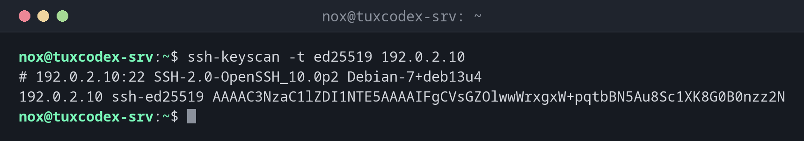

# ssh-keyscan

> Holt die öffentlichen Host-Keys von SSH-Servern, ohne sich anzumelden. Nützlich, um Fingerprints zu prüfen und `known_hosts` vorab zu füllen.



## Syntax

```bash
ssh-keyscan [OPTION]... HOST...
```

## Optionen

| Option | Beschreibung |
|--------|--------------|
| `-t TYP` | Nur diesen Schlüsseltyp, z. B. `ed25519` |
| `-p PORT` | SSH-Port des Servers |
| `-H` | Die Hostnamen hashen, wie es `known_hosts` meist tut |
| `-T SEKUNDEN` | Zeitlimit pro Host |

## Beispiele

**Den Host-Key eines Servers holen:**

```bash
ssh-keyscan -t ed25519 192.0.2.10
```

```text
# 192.0.2.10:22 SSH-2.0-OpenSSH_10.0p2 Debian-7+deb13u4
192.0.2.10 ssh-ed25519 AAAAC3NzaC1lZDI1NTE5AAAAIFgCVsGZOlwwWrxgxW+pqtbBN5Au8Sc1XK8G0B0nzz2N
```

Die Zeile mit `#` kommt von der Standardfehlerausgabe und zeigt die SSH-Version des
Servers. Die zweite Zeile hat das Format von `known_hosts`.

**Den Fingerprint des Host-Keys anzeigen:**

```bash
ssh-keyscan -t ed25519 192.0.2.10 2>/dev/null | ssh-keygen -lf -
```

```text
256 SHA256:3qrz2WaaPN7BZOUbSTXHRndWQcm8gTxZgtaniXKLSGs 192.0.2.10 (ED25519)
```

Vergleiche ihn mit dem Fingerprint, den SSH bei der ersten Verbindung zeigt, oder mit dem,
den dir der Admin des Servers nennt.

**Einen Server vorab in `known_hosts` eintragen:**

```bash
ssh-keyscan -H -t ed25519 192.0.2.10 >> ~/.ssh/known_hosts
```

```text
# 192.0.2.10:22 SSH-2.0-OpenSSH_10.0p2 Debian-7+deb13u4
```

Nur die Kommentarzeile landet auf dem Bildschirm, der Schlüssel geht in die Datei. Danach
fragt die erste Verbindung nicht mehr nach.

**Die SSH-Versionen mehrerer Server prüfen:**

```bash
ssh-keyscan 192.0.2.10 192.0.2.20 198.51.100.7 2>&1 >/dev/null | sort -u
```

```text
# 192.0.2.10:22 SSH-2.0-OpenSSH_10.0p2 Debian-7+deb13u4
# 192.0.2.20:22 SSH-2.0-OpenSSH_9.9
# 198.51.100.7:22 SSH-2.0-OpenSSH_9.6p1 Ubuntu-3ubuntu13.14
```

## Wann brauche ich das?

- Vor der ersten Verbindung, um den Fingerprint über einen zweiten, vertrauenswürdigen Weg
  zu vergleichen
- In der Automatisierung, um neue Server ohne Rückfrage in `known_hosts` einzutragen
- Für einen schnellen Überblick über die SSH-Versionen in einem Netz

!!! tip "Fingerprints auf dem Server prüfen"
    Auf dem Server selbst zeigt `ssh-keygen -lf /etc/ssh/ssh_host_ed25519_key.pub` den
    echten Fingerprint. Stimmt er mit dem geholten überein, sitzt niemand dazwischen.

!!! warning "`ssh-keyscan` vertraut dem Netz"
    Das Werkzeug nimmt jeden Schlüssel, den das Netz liefert. Schlüssel blind mit
    `ssh-keyscan >> known_hosts` einzutragen, überspringt genau die Prüfung, die dich vor
    Man-in-the-Middle-Angriffen schützt. Vergleiche den Fingerprint mindestens einmal.

## Verwandte Befehle

[ssh-keygen](ssh-keygen.md) · [ssh](ssh.md) · [sshd](sshd.md)
