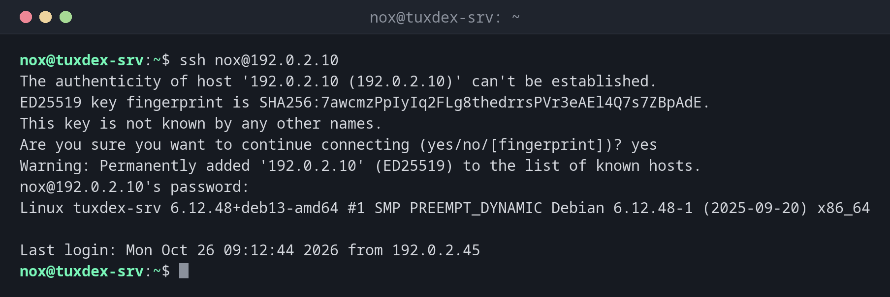

# ssh

> Logs in to a remote server over an encrypted connection, runs commands there and tunnels other connections through it.



## Syntax

```bash
ssh [OPTION]... [USER@]HOST [COMMAND]
```

## Options

| Option | Description |
|--------|-------------|
| `-p PORT` | Connect to a different port than `22` |
| `-i FILE` | Use this private key |
| `-J HOST` | Connect through a jump host |
| `-L LPORT:HOST:PORT` | Local tunnel: `LPORT` on your machine leads to `HOST:PORT` as seen from the server |
| `-R RPORT:HOST:PORT` | Remote tunnel: a port on the server leads back to your side |
| `-D PORT` | Dynamic tunnel: a SOCKS proxy through the server |
| `-N`, `-f` | No remote command, go to the background (for tunnels) |
| `-t` | Force a terminal, e.g. for `sudo` in a remote command |
| `-v` | Show debug output, to find login problems |

## Examples

**Connect to a server for the first time:**

```bash
ssh nox@192.0.2.10
```

```text
The authenticity of host '192.0.2.10 (192.0.2.10)' can't be established.
ED25519 key fingerprint is SHA256:7awcmzPpIyIq2FLg8thedrrsPVr3eAEl4Q7s7ZBpAdE.
This key is not known by any other names.
Are you sure you want to continue connecting (yes/no/[fingerprint])? yes
Warning: Permanently added '192.0.2.10' (ED25519) to the list of known hosts.
nox@192.0.2.10's password:
Linux tuxcodex-srv 6.12.48+deb13-amd64 #1 SMP PREEMPT_DYNAMIC Debian 6.12.48-1 (2025-09-20) x86_64

Last login: Mon Oct 26 09:12:44 2026 from 192.0.2.45
```

Compare the fingerprint with the one the server administrator or the hosting console
shows you, before you answer `yes`.

**Run a single command on the server:**

```bash
ssh nox@192.0.2.10 uptime
```

```text
 10:42:17 up 12 days,  3:05,  2 users,  load average: 0.08, 0.03, 0.01
```

With a host from `~/.ssh/config` (see [basics](basics.md)), `web` is enough instead of
`nox@192.0.2.10`.

**Reach a database that only listens on the server itself:**

```bash
ssh -f -N -L 5433:127.0.0.1:5432 nox@192.0.2.10
ss -tln | grep 5433
```

```text
LISTEN 0      128        127.0.0.1:5433      0.0.0.0:*
```

Port `5433` on your machine now leads to `127.0.0.1:5432` on the server. Your database
tool connects to `localhost:5433`, the database itself stays closed to the outside.

**Connect through a jump host:**

```bash
ssh -J nox@192.0.2.10 nox@192.0.2.20 hostname
```

```text
tuxcodex-db
```

The database server `192.0.2.20` isn't reachable from outside. `-J` connects through
`192.0.2.10` in one step.

**The host key has changed:**

```bash
ssh nox@192.0.2.10
```

```text
@@@@@@@@@@@@@@@@@@@@@@@@@@@@@@@@@@@@@@@@@@@@@@@@@@@@@@@@@@@
@    WARNING: REMOTE HOST IDENTIFICATION HAS CHANGED!     @
@@@@@@@@@@@@@@@@@@@@@@@@@@@@@@@@@@@@@@@@@@@@@@@@@@@@@@@@@@@
IT IS POSSIBLE THAT SOMEONE IS DOING SOMETHING NASTY!
Someone could be eavesdropping on you right now (man-in-the-middle attack)!
It is also possible that a host key has just been changed.
The fingerprint for the ED25519 key sent by the remote host is
SHA256:3qrz2WaaPN7BZOUbSTXHRndWQcm8gTxZgtaniXKLSGs.
Please contact your system administrator.
Add correct host key in /home/nox/.ssh/known_hosts to get rid of this message.
Offending ED25519 key in /home/nox/.ssh/known_hosts:3
  remove with:
  ssh-keygen -f '/home/nox/.ssh/known_hosts' -R '192.0.2.10'
Host key for 192.0.2.10 has changed and you have requested strict checking.
Host key verification failed.
```

SSH refuses the connection. If the server was reinstalled, remove the old key with the
command shown and connect again. If not, find out why first.

## When do I need it?

- For every administration task on a remote server
- To reach services that are only reachable on the server itself, such as databases
- To reach servers in an internal network through a jump host

!!! tip "Debug login problems"
    `ssh -v nox@192.0.2.10` shows which keys are offered and which methods the server
    accepts. The lines `Offering public key` and `Authentications that can continue`
    usually reveal the problem.

!!! warning "Escape a frozen session"
    If the connection hangs, type ++enter++, then `~.` (tilde, dot). SSH ends the session
    immediately, even if the server no longer answers.

## Related commands

[ssh-keygen](ssh-keygen.md) · [ssh-copy-id](ssh-copy-id.md) · [scp](scp.md) · [sshd](sshd.md) · [ssh-keygen](ssh-keygen.md) · [ssh-copy-id](ssh-copy-id.md) · [scp](scp.md)
