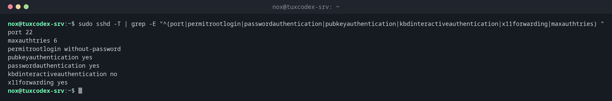

# sshd

> Der SSH-Server. Von Hand startest du ihn selten, aber du prüfst mit ihm seine Konfiguration, bevor du den Dienst neu lädst.



## Syntax

```bash
sshd [OPTION]...
```

Die Konfiguration liegt in `/etc/ssh/sshd_config`. Eigene Einstellungen gehören in eine Datei in `/etc/ssh/sshd_config.d/`, die Paketupdates übersteht.

## Optionen

| Option | Beschreibung |
|--------|--------------|
| `-t` | Die Konfiguration testen, nichts ausgeben, wenn sie stimmt |
| `-T` | Die wirksame Konfiguration ausgeben, alle Einstellungen kleingeschrieben |
| `-T -C user=NAME,host=HOST,addr=IP` | Wirksame Konfiguration für eine bestimmte Verbindung (`Match`-Blöcke) |
| `-d` | Debug-Modus im Vordergrund, für eine Verbindung |

Wichtige Einstellungen:

| Einstellung | Empfohlen | Bedeutung |
|-------------|-----------|-----------|
| `PermitRootLogin` | `no` | Keine direkte Anmeldung als root, `sudo` nutzen |
| `PasswordAuthentication` | `no` | Nur Schlüssel, keine Passwörter |
| `MaxAuthTries` | `3` | Anmeldeversuche pro Verbindung |
| `AllowUsers` | deine Benutzer | Nur diese Benutzer dürfen sich anmelden |
| `X11Forwarding` | `no` | Keine grafischen Programme, auf Servern unnötig |

## Beispiele

**Die aktuell wirksamen Einstellungen anzeigen:**

```bash
sudo sshd -T | grep -E "^(port|permitrootlogin|passwordauthentication|pubkeyauthentication|kbdinteractiveauthentication|x11forwarding|maxauthtries) "
```

```text
port 22
maxauthtries 6
permitrootlogin without-password
pubkeyauthentication yes
passwordauthentication yes
kbdinteractiveauthentication no
x11forwarding yes
```

**Eine Datei zum Absichern:**

```bash
cat /etc/ssh/sshd_config.d/10-hardening.conf
```

```text
PermitRootLogin no
PasswordAuthentication no
KbdInteractiveAuthentication no
MaxAuthTries 3
X11Forwarding no
AllowUsers nox alice
```

Unter Debian und Ubuntu werden Dateien in `sshd_config.d/` zuerst gelesen, und der
**erste** gefundene Wert einer Einstellung gewinnt. Deshalb überschreibt deine eigene Datei
die Vorgaben weiter unten.

**Die Konfiguration vor dem Neuladen testen:**

```bash
sudo sshd -t && echo "config ok"
```

```text
config ok
```

**Ein Tippfehler in der Konfiguration:**

```bash
sudo sshd -t
```

```text
/etc/ssh/sshd_config.d/10-hardening.conf line 1: unsupported option "noo".
```

Mit diesem Fehler würde `sshd` gar nicht starten. Korrigiere die Zeile und teste erneut,
bevor du den Dienst neu lädst.

**Neu laden und das Ergebnis prüfen:**

```bash
sudo systemctl reload ssh
sudo sshd -T | grep -E "^(port|permitrootlogin|passwordauthentication|pubkeyauthentication|kbdinteractiveauthentication|x11forwarding|maxauthtries) "
```

```text
port 22
maxauthtries 3
permitrootlogin no
pubkeyauthentication yes
passwordauthentication no
kbdinteractiveauthentication no
x11forwarding no
```

## Wann brauche ich das?

- Beim Einrichten eines neuen Servers: Root- und Passwort-Anmeldung abschalten
- Vor jedem Neuladen des SSH-Dienstes, um Tippfehler auszuschließen
- Um herauszufinden, welcher Wert wirklich gilt, wenn mehrere Dateien dieselbe Option
  setzen

!!! tip "Neu laden statt neu starten"
    `sudo systemctl reload ssh` liest die Konfiguration neu, ohne bestehende Verbindungen zu
    beenden. Deine aktuelle Sitzung bleibt offen, selbst wenn die neuen Einstellungen
    falsch sind.

!!! danger "In einer zweiten Sitzung testen"
    Öffne nach dem Abschalten der Passwort-Anmeldung eine **neue** SSH-Sitzung, bevor du
    die alte schließt. Klappt die neue nicht, kannst du die Änderung in der alten noch
    zurücknehmen.

## Unterschiede zwischen Distributionen

| | Debian | Ubuntu | RHEL | Arch |
|---|--------|--------|------|------|
| Dienst | `ssh` | `ssh` | `sshd` | `sshd` |
| Neu laden | `sudo systemctl reload ssh` | `sudo systemctl reload ssh` | `sudo systemctl reload sshd` | `sudo systemctl reload sshd` |

## Verwandte Befehle

[ssh](ssh.md) · [systemctl](../09-systemd/systemctl.md) · [journalctl](../09-systemd/journalctl.md)
