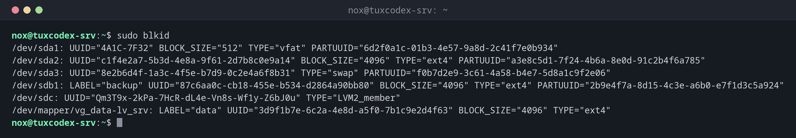

# blkid

> Zeigt UUID, Label und Dateisystemtyp von Blockgeräten. Die Quelle für UUIDs in `/etc/fstab`.



## Syntax

```bash
blkid [OPTION]... [GERÄT]...
```

Führe es mit `sudo` aus: Ohne root zeigt `blkid` womöglich zwischengespeicherte oder unvollständige Angaben.

## Optionen

| Option | Beschreibung |
|--------|--------------|
| *(keine)* | Alle Geräte mit ihren Eigenschaften |
| `-s TAG` | Nur diese Eigenschaft, z. B. `UUID` oder `TYPE` |
| `-o value` | Nur den Wert, ohne `TAG=` |
| `-L LABEL`, `-U UUID` | Das Gerät mit diesem Label oder dieser UUID finden |

## Beispiele

**Alle Dateisysteme mit UUID und Typ anzeigen:**

```bash
sudo blkid
```

```text
/dev/sda1: UUID="4A1C-7F32" BLOCK_SIZE="512" TYPE="vfat" PARTUUID="6d2f0a1c-01b3-4e57-9a8d-2c41f7e0b934"
/dev/sda2: UUID="c1f4e2a7-5b3d-4e8a-9f61-2d7b8c0e9a14" BLOCK_SIZE="4096" TYPE="ext4" PARTUUID="a3e8c5d1-7f24-4b6a-8e0d-91c2b4f6a785"
/dev/sda3: UUID="8e2b6d4f-1a3c-4f5e-b7d9-0c2e4a6f8b31" TYPE="swap" PARTUUID="f0b7d2e9-3c61-4a58-b4e7-5d8a1c9f2e06"
/dev/sdb1: LABEL="backup" UUID="87c6aa0c-cb18-455e-b534-d2864a90bb80" BLOCK_SIZE="4096" TYPE="ext4" PARTUUID="2b9e4f7a-8d15-4c3e-a6b0-e7f1d3c5a924"
/dev/sdc: UUID="Qm3T9x-2kPa-7HcR-dL4e-Vn8s-Wf1y-Z6bJ0u" TYPE="LVM2_member"
/dev/mapper/vg_data-lv_srv: LABEL="data" UUID="3d9f1b7e-6c2a-4e8d-a5f0-7b1c9e2d4f63" BLOCK_SIZE="4096" TYPE="ext4"
```

**Nur die UUID einer Partition, für ein Skript:**

```bash
sudo blkid -s UUID -o value /dev/sdb1
```

```text
87c6aa0c-cb18-455e-b534-d2864a90bb80
```

**Das Gerät mit einem Label finden:**

```bash
sudo blkid -L backup
```

```text
/dev/sdb1
```

**Die Zeile für `/etc/fstab` zusammenbauen:**

```bash
echo "UUID=$(sudo blkid -s UUID -o value /dev/sdb1) /mnt/backup ext4 defaults,nofail 0 2"
```

```text
UUID=87c6aa0c-cb18-455e-b534-d2864a90bb80 /mnt/backup ext4 defaults,nofail 0 2
```

## Wann brauche ich das?

- Bevor du ein Dateisystem in `/etc/fstab` einträgst
- Um herauszufinden, welches Dateisystem auf einer Partition liegt
- Wenn ein Einhängen scheitert und du die UUID in `/etc/fstab` prüfen willst

!!! warning "Neue UUID nach dem Formatieren"
    `mkfs` erzeugt jedes Mal eine neue UUID. Formatierst du eine Partition neu, passe auch die
    Zeile in `/etc/fstab` an, sonst wird sie beim nächsten Booten nicht eingehängt.

## Verwandte Befehle

[lsblk](lsblk.md) · [mount](mount.md) · [findmnt](findmnt.md) · [mkfs](mkfs.md)
