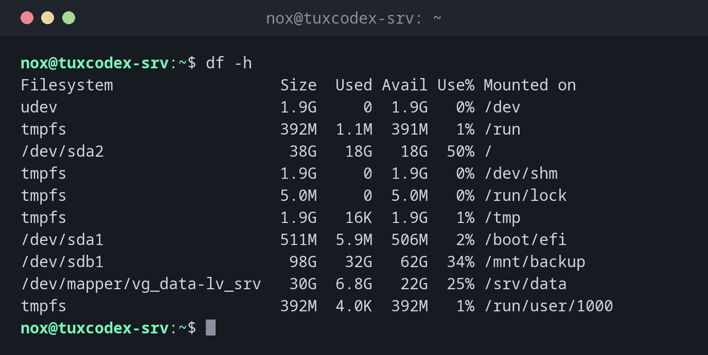

# df

> Zeigt, wie viel Platz auf jedem eingehängten Dateisystem belegt und frei ist.



## Syntax

```bash
df [OPTION]... [DATEI]...
```

## Optionen

| Option | Beschreibung |
|--------|--------------|
| `-h` | Lesbare Größen (`G`, `M`) |
| `-T` | Auch den Dateisystemtyp zeigen |
| `-x TYP` | Einen Typ ausschließen, z. B. `-x tmpfs -x devtmpfs` |
| `-i` | Inodes statt Bytes |
| `DATEI` | Nur das Dateisystem, das `DATEI` enthält |

## Beispiele

**Alle Dateisysteme anzeigen:**

```bash
df -h
```

```text
Filesystem                  Size  Used Avail Use% Mounted on
udev                        1.9G     0  1.9G   0% /dev
tmpfs                       392M  1.1M  391M   1% /run
/dev/sda2                    38G   18G   18G  50% /
tmpfs                       1.9G     0  1.9G   0% /dev/shm
tmpfs                       5.0M     0  5.0M   0% /run/lock
tmpfs                       1.9G   16K  1.9G   1% /tmp
/dev/sda1                   511M  5.9M  506M   2% /boot/efi
/dev/sdb1                    98G   32G   62G  34% /mnt/backup
/dev/mapper/vg_data-lv_srv   30G  6.8G   22G  25% /srv/data
tmpfs                       392M  4.0K  392M   1% /run/user/1000
```

Die `tmpfs`-Zeilen sind Dateisysteme im Arbeitsspeicher. Unter Debian 13 gehört `/tmp` dazu.

**Nur echte Platten, mit Typ:**

```bash
df -hT -x tmpfs -x devtmpfs
```

```text
Filesystem                 Type  Size  Used Avail Use% Mounted on
/dev/sda2                  ext4   38G   18G   18G  50% /
/dev/sda1                  vfat  511M  5.9M  506M   2% /boot/efi
/dev/sdb1                  ext4   98G   32G   62G  34% /mnt/backup
/dev/mapper/vg_data-lv_srv ext4   30G  6.8G   22G  25% /srv/data
```

**Nur das Dateisystem eines Verzeichnisses:**

```bash
df -h /var/log
```

```text
Filesystem      Size  Used Avail Use% Mounted on
/dev/sda2        38G   18G   18G  50% /
```

**Die Inodes prüfen:**

```bash
df -i /
```

```text
Filesystem      Inodes  IUsed   IFree IUse% Mounted on
/dev/sda2      2523136 412883 2110253   17% /
```

Jede Datei braucht einen Inode. Millionen winziger Dateien, etwa Session-Dateien, können
alle Inodes verbrauchen, obwohl noch Platz frei ist.

## Wann brauche ich das?

- Wenn ein Server `No space left on device` meldet
- Regelmäßig, um volle Platten zu bemerken, bevor sie zum Problem werden
- Nach dem Aufräumen, um zu prüfen, wie viel Platz frei wurde

!!! tip "Platte voll, aber `du` findet nichts?"
    Meldet `df` viel mehr belegten Platz, als `du` findet, ist vermutlich eine gelöschte Datei
    noch geöffnet. [`lsof +L1`](../08-processes/lsof.md) zeigt sie.

!!! warning "Volle Platten legen Dienste lahm"
    Bei 100 % schreiben Datenbanken nicht mehr, Logs gehen verloren und Anmeldungen können
    scheitern. Richte ein Monitoring ein, das ab etwa 85 % warnt.

## Verwandte Befehle

[du](du.md) · [ncdu](ncdu.md) · [findmnt](findmnt.md) · [lsof](../08-processes/lsof.md)
