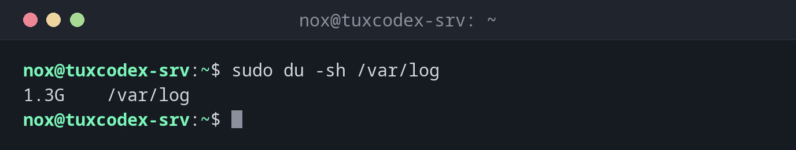

# du

> Shows how much space files and directories take up. The tool to find out what fills a disk.



## Syntax

```bash
du [OPTION]... [FILE]...
```

## Options

| Option | Description |
|--------|-------------|
| `-s` | Only the total per argument |
| `-h` | Human readable sizes |
| `-d N`, `--max-depth=N` | Only show directories up to depth `N` |
| `-x` | Stay on this file system, don't follow other mounts |
| `-a` | Also list files, not only directories |
| `--apparent-size` | Size of the content instead of the space used on disk |

## Examples

**Size of a directory:**

```bash
sudo du -sh /var/log
```

```text
1.3G    /var/log
```

**Find the largest directories, sorted:**

```bash
sudo du -h -d 1 -x /var | sort -h
```

```text
4.0K    /var/local
4.0K    /var/opt
16K     /var/tmp
1.1M    /var/spool
48M     /var/backups
402M    /var/cache
612M    /var/lib
1.3G    /var/log
2.3G    /var
```

**The five largest subdirectories of the logs:**

```bash
sudo du -h -d 1 /var/log | sort -rh | sed -n '2,6p'
```

```text
812M    /var/log/nginx
214M    /var/log/journal
98M     /var/log/postgresql
41M     /var/log/apt
12M     /var/log/installer
```

`sed -n '2,6p'` skips the first line, the total of `/var/log` itself.

**The largest single files:**

```bash
sudo du -ah /var/log/nginx | sort -rh | sed -n '2,3p'
```

```text
4.0G    /var/log/nginx/access.log.1
1.0G    /var/log/nginx/access.log
```

## When do I need it?

- When `df` shows a full disk: which directory is responsible?
- To find large log files or forgotten backups
- Before a migration, to know how much data has to be moved

!!! tip "Combine with `sort -h`"
    `du -h | sort -h` sorts human readable sizes correctly: `4.0K` before `1.2M` before
    `3.4G`. The largest entries are at the end.

!!! warning "Slow on large directories"
    `du` reads every file. On directories with millions of files it can take minutes and
    put load on the disk. Limit it with `-d 1` and `-x`.

## Related commands

[df](df.md) · [ncdu](ncdu.md) · [sort](../05-text-processing/sort.md) · [find](../02-navigation/find.md)
