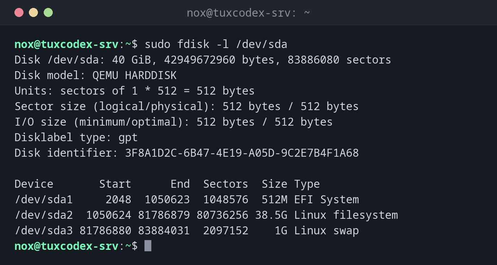

# fdisk

> Shows and changes partition tables, interactively and step by step. Nothing is written to the disk until you confirm with `w`.



## Syntax

```bash
fdisk [OPTION]... DEVICE
```

## Options

| Option | Description |
|--------|-------------|
| `-l [DEVICE]` | List the partition tables |
| `DEVICE` | Edit the partition table of this disk interactively |

Commands inside `fdisk`: `p` print, `g` new GPT table, `n` new partition, `t` change the type, `d` delete, `w` write and quit, `q` quit without saving, `m` help.

## Examples

**Show the partition table of the system disk:**

```bash
sudo fdisk -l /dev/sda
```

```text
Disk /dev/sda: 40 GiB, 42949672960 bytes, 83886080 sectors
Disk model: QEMU HARDDISK
Units: sectors of 1 * 512 = 512 bytes
Sector size (logical/physical): 512 bytes / 512 bytes
I/O size (minimum/optimal): 512 bytes / 512 bytes
Disklabel type: gpt
Disk identifier: 3F8A1D2C-6B47-4E19-A05D-9C2E7B4F1A68

Device       Start      End  Sectors  Size Type
/dev/sda1     2048  1050623  1048576  512M EFI System
/dev/sda2  1050624 81786879 80736256 38.5G Linux filesystem
/dev/sda3 81786880 83884031  2097152    1G Linux swap
```

**Create one partition on a new disk:**

```bash
sudo fdisk /dev/sdd
```

```text
Welcome to fdisk (util-linux 2.41.5).
Changes will remain in memory only, until you decide to write them.
Be careful before using the write command.

Device does not contain a recognized partition table.
Created a new DOS (MBR) disklabel with disk identifier 0x5c2e91a7.

Command (m for help): g
Created a new GPT disklabel (GUID: 7E3B9C14-2F6A-4D85-9B1E-C04A8D27F5B3).

Command (m for help): n
Partition number (1-128, default 1):
First sector (2048-104857566, default 2048):
Last sector, +/-sectors or +/-size{K,M,G,T,P} (2048-104857566, default 104855551):

Created a new partition 1 of type 'Linux filesystem' and of size 50 GiB.

Command (m for help): w
The partition table has been altered.
Calling ioctl() to re-read partition table.
Syncing disks.
```

`g` creates a GPT table, `n` with three times ++enter++ creates a partition over the
whole disk, `w` writes the result.

**Check the result:**

```bash
sudo fdisk -l /dev/sdd
```

```text
Disk /dev/sdd: 50 GiB, 53687091200 bytes, 104857600 sectors
Disk model: QEMU HARDDISK
Units: sectors of 1 * 512 = 512 bytes
Sector size (logical/physical): 512 bytes / 512 bytes
I/O size (minimum/optimal): 512 bytes / 512 bytes
Disklabel type: gpt
Disk identifier: 7E3B9C14-2F6A-4D85-9B1E-C04A8D27F5B3

Device     Start       End   Sectors Size Type
/dev/sdd1   2048 104855551 104853504  50G Linux filesystem
```

## When do I need it?

- When a new disk is added to a server and needs a partition
- To check the partition table of a disk
- To change the type of a partition, e.g. to `Linux swap` or `Linux LVM`

!!! tip "No partition needed for LVM"
    For LVM, you can use the whole disk without a partition: `pvcreate /dev/sdd`. Many
    admins still create one partition of type `Linux LVM`, so other tools recognise the disk
    as used.

!!! danger "The wrong disk"
    `fdisk` on the wrong device destroys the partition table of a disk in use. Check the
    name with [`lsblk`](lsblk.md) and look at the size before you write with `w`.

## Related commands

[parted](parted.md) · [lsblk](lsblk.md) · [mkfs](mkfs.md)
