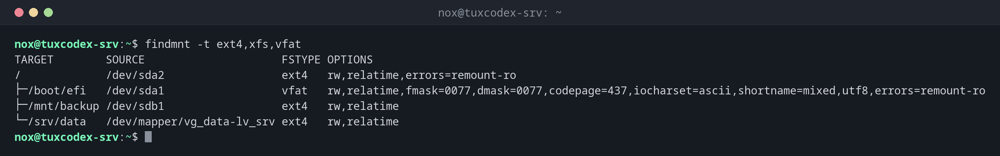

# findmnt

> Zeigt eingehängte Dateisysteme als Baum, findet heraus, woher ein Pfad eingehängt ist, und prüft `/etc/fstab` auf Fehler.



## Syntax

```bash
findmnt [OPTION]... [GERÄT | EINHÄNGEPUNKT]
```

## Optionen

| Option | Beschreibung |
|--------|--------------|
| `-t TYPEN` | Nur diese Dateisystemtypen, z. B. `ext4,xfs` |
| `-T PFAD` | Das Dateisystem, das `PFAD` enthält |
| `-D` | Ausgabe wie `df`: Größe, belegt, verfügbar |
| `--verify` | `/etc/fstab` auf Fehler prüfen |
| `-s` | `/etc/fstab` statt der eingehängten Dateisysteme zeigen |

## Beispiele

**Die echten Dateisysteme als Baum anzeigen:**

```bash
findmnt -t ext4,xfs,vfat
```

```text
TARGET        SOURCE                     FSTYPE OPTIONS
/             /dev/sda2                  ext4   rw,relatime,errors=remount-ro
├─/boot/efi   /dev/sda1                  vfat   rw,relatime,fmask=0077,dmask=0077,codepage=437,iocharset=ascii,shortname=mixed,utf8,errors=remount-ro
├─/mnt/backup /dev/sdb1                  ext4   rw,relatime
└─/srv/data   /dev/mapper/vg_data-lv_srv ext4   rw,relatime
```

**Herausfinden, auf welchem Dateisystem ein Verzeichnis liegt:**

```bash
findmnt -T /srv/data/uploads
```

```text
TARGET    SOURCE                     FSTYPE OPTIONS
/srv/data /dev/mapper/vg_data-lv_srv ext4   rw,relatime
```

**Größe und Belegung eines Einhängepunkts:**

```bash
findmnt -D /srv/data
```

```text
SOURCE                     FSTYPE  SIZE USED AVAIL USE% TARGET
/dev/mapper/vg_data-lv_srv ext4   29.4G 6.8G 21.1G  23% /srv/data
```

**`/etc/fstab` nach einer Änderung prüfen:**

```bash
sudo findmnt --verify
```

```text
Success, no errors or warnings detected
```

## Wann brauche ich das?

- Um zu sehen, welche Dateisysteme eingehängt sind, ohne den Ballast von `mount`
- Um herauszufinden, auf welcher Platte ein Verzeichnis wirklich liegt
- Nach jeder Änderung an `/etc/fstab`, vor dem Neustart

!!! tip "Übersichtlicher als `mount`"
    `mount` ohne Argumente listet Dutzende virtuelle Dateisysteme. `findmnt -t ext4,xfs,vfat`
    zeigt nur die echten, als Baum.

## Verwandte Befehle

[mount](mount.md) · [df](df.md) · [lsblk](lsblk.md)
