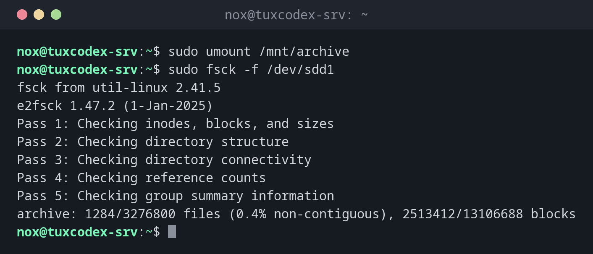

# fsck

> Prüft ein Dateisystem auf Fehler und repariert sie. `fsck` ruft das passende Werkzeug für den Typ auf, z. B. `e2fsck` für ext4.



## Syntax

```bash
fsck [OPTION]... GERÄT
```

Prüfe nur Dateisysteme, die **nicht eingehängt** sind. Für das Root-Dateisystem läuft die Prüfung beim Booten.

## Optionen

| Option | Beschreibung |
|--------|--------------|
| `-f` | Auch prüfen, wenn das Dateisystem als sauber markiert ist |
| `-n` | Nur prüfen, nichts ändern, jede Frage mit Nein beantworten |
| `-y` | Jede Reparaturfrage mit Ja beantworten |
| `-C` | Einen Fortschrittsbalken zeigen |

## Beispiele

**Ein ausgehängtes Dateisystem prüfen:**

```bash
sudo umount /mnt/archive
sudo fsck -f /dev/sdd1
```

```text
fsck from util-linux 2.41.5
e2fsck 1.47.2 (1-Jan-2025)
Pass 1: Checking inodes, blocks, and sizes
Pass 2: Checking directory structure
Pass 3: Checking directory connectivity
Pass 4: Checking reference counts
Pass 5: Checking group summary information
archive: 1284/3276800 files (0.4% non-contiguous), 2513412/13106688 blocks
```

Fünf Durchläufe ohne Meldung: Das Dateisystem ist in Ordnung.

**Versuch auf einem eingehängten Dateisystem:**

```bash
sudo fsck /dev/sdb1
```

```text
fsck from util-linux 2.41.5
e2fsck 1.47.2 (1-Jan-2025)
/dev/sdb1 is mounted.
e2fsck: Cannot continue, aborting.
```

**Fehler automatisch reparieren:**

```bash
sudo fsck -y /dev/sdd1; echo "exit $?"
```

```text
fsck from util-linux 2.41.5
e2fsck 1.47.2 (1-Jan-2025)
archive contains a file system with errors, check forced.
Pass 1: Checking inodes, blocks, and sizes
Pass 2: Checking directory structure
Entry 'cache.tmp' in /data (393217) has deleted/unused inode 393244.  Clear? yes

Pass 3: Checking directory connectivity
Pass 4: Checking reference counts
Pass 5: Checking group summary information
Block bitmap differences:  -(1605674--1605681)
Fix? yes

Free blocks count wrong for group #49 (24510, counted=24518).
Fix? yes


archive: ***** FILE SYSTEM WAS MODIFIED *****
archive: 1283/3276800 files (0.4% non-contiguous), 2513404/13106688 blocks
exit 1
```

Exit-Code `1` heißt: Fehler gefunden und behoben. `4` hieße: Es sind Fehler übrig.

## Wann brauche ich das?

- Nach einem Absturz oder Stromausfall, wenn der Kernel Dateisystemfehler meldet
- Wenn ein Dateisystem wegen Fehlern nur lesend eingehängt wurde
- Vor dem Verkleinern eines ext4-Dateisystems, `resize2fs` verlangt es

!!! tip "Das Root-Dateisystem beim nächsten Booten prüfen"
    Auf Systemen mit systemd erzwingt der Kernel-Parameter `fsck.mode=force` beim nächsten
    Booten eine Prüfung aller Dateisysteme, auch `/`.

!!! warning "Vor dem Reparieren sichern"
    `fsck -y` repariert alles, was es findet, und kann dabei beschädigte Dateien löschen. Sind
    die Daten wichtig, kopiere die Partition vorher, zum Beispiel mit `dd`.

!!! danger "Nie auf einem eingehängten Dateisystem"
    `fsck` auf einem eingehängten Dateisystem kann es zerstören. e2fsck weigert sich, aber
    andere Werkzeuge und `-f`-Kombinationen schützen dich nicht immer.

## Unterschiede zwischen Distributionen

| | Debian | Ubuntu | RHEL | Arch |
|---|--------|--------|------|------|
| Standard-Dateisystem | ext4, `e2fsck` | ext4, `e2fsck` | XFS, `xfs_repair` statt `fsck` | ext4, `e2fsck` |

## Verwandte Befehle

[umount](umount.md) · [resize2fs](resize2fs.md) · [mount](mount.md)
