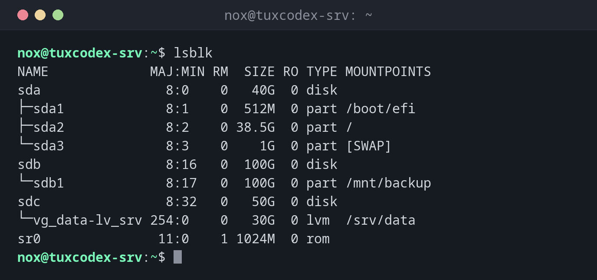

# lsblk

> Lists all block devices as a tree: disks, partitions, LVM volumes, with size and mount point.



## Syntax

```bash
lsblk [OPTION]... [DEVICE]...
```

## Options

| Option | Description |
|--------|-------------|
| `-f` | Show file systems: type, label, UUID, free space |
| `-o COLUMNS` | Choose the columns, e.g. `NAME,SIZE,MODEL` |
| `-d` | Only disks, no partitions |
| `-p` | Show full paths like `/dev/sda1` |
| `-e 7` | Exclude loop devices (major number 7) |

## Examples

**Show all disks and partitions:**

```bash
lsblk
```

```text
NAME             MAJ:MIN RM  SIZE RO TYPE MOUNTPOINTS
sda                8:0    0   40G  0 disk
├─sda1             8:1    0  512M  0 part /boot/efi
├─sda2             8:2    0 38.5G  0 part /
└─sda3             8:3    0    1G  0 part [SWAP]
sdb                8:16   0  100G  0 disk
└─sdb1             8:17   0  100G  0 part /mnt/backup
sdc                8:32   0   50G  0 disk
└─vg_data-lv_srv 254:0    0   30G  0 lvm  /srv/data
sr0               11:0    1 1024M  0 rom
```

`sda` is the system disk with three partitions, `sdb` the backup disk, and `sdc` belongs to
LVM. `RM 1` marks removable devices like the virtual DVD drive `sr0`.

**Show file systems, UUIDs and free space:**

```bash
lsblk -f
```

```text
NAME             FSTYPE      FSVER    LABEL  UUID                                   FSAVAIL FSUSE% MOUNTPOINTS
sda
├─sda1           vfat        FAT32           4A1C-7F32                               505.8M     1% /boot/efi
├─sda2           ext4        1.0             c1f4e2a7-5b3d-4e8a-9f61-2d7b8c0e9a14     17.9G    47% /
└─sda3           swap        1               8e2b6d4f-1a3c-4f5e-b7d9-0c2e4a6f8b31                [SWAP]
sdb
└─sdb1           ext4        1.0      backup 87c6aa0c-cb18-455e-b534-d2864a90bb80     61.2G    33% /mnt/backup
sdc              LVM2_member LVM2 001        Qm3T9x-2kPa-7HcR-dL4e-Vn8s-Wf1y-Z6bJ0u
└─vg_data-lv_srv ext4        1.0      data   3d9f1b7e-6c2a-4e8d-a5f0-7b1c9e2d4f63     21.4G    23% /srv/data
```

**Only the disks with model and serial number:**

```bash
lsblk -d -e 7,11 -o NAME,SIZE,MODEL,SERIAL,TYPE
```

```text
NAME   SIZE MODEL           SERIAL       TYPE
sda     40G QEMU HARDDISK   drive-scsi0  disk
sdb    100G QEMU HARDDISK   drive-scsi1  disk
sdc     50G QEMU HARDDISK   drive-scsi2  disk
```

**Show a newly added disk:**

```bash
lsblk /dev/sdd
```

```text
NAME MAJ:MIN RM SIZE RO TYPE MOUNTPOINTS
sdd    8:48   0  50G  0 disk
```

No partitions, no mount point: the disk is empty and ready for [`fdisk`](fdisk.md).

## When do I need it?

- To get an overview of a server: which disks are there and how are they divided?
- After adding a disk, to find its name
- To find the UUID or the file system of a partition

!!! tip "Find the new disk"
    A new disk has no partitions and no mount point. Compare `lsblk` before and after
    adding it, the new line is the new disk.

## Related commands

[blkid](blkid.md) · [df](df.md) · [findmnt](findmnt.md) · [fdisk](fdisk.md)
