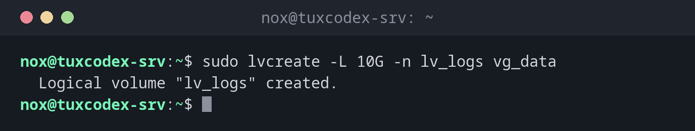

# lvcreate

> Legt in einer Volume Group ein neues logisches Volume an: eine flexible „Partition“, die du formatieren, einhängen und später vergrößern kannst.



## Syntax

```bash
lvcreate [OPTION]... VG
```

## Optionen

| Option | Beschreibung |
|--------|--------------|
| `-L GRÖSSE` | Größe, z. B. `20G` |
| `-l 100%FREE` | Den ganzen freien Platz der Gruppe nutzen |
| `-n NAME` | Name des Volumes |
| `-s` | Einen Snapshot eines vorhandenen Volumes anlegen |

## Beispiele

**Ein Volume mit 10 GiB für Logs anlegen:**

```bash
sudo lvcreate -L 10G -n lv_logs vg_data
```

```text
  Logical volume "lv_logs" created.
```

**Formatieren und einhängen:**

```bash
sudo mkfs.ext4 -q -L logs /dev/vg_data/lv_logs
sudo mkdir -p /srv/logs
sudo mount /dev/vg_data/lv_logs /srv/logs
sudo lvs
```

```text
  LV      VG      Attr       LSize  Pool Origin Data%  Meta%  Move Log Cpy%Sync Convert
  lv_logs vg_data -wi-ao---- 10.00g
  lv_srv  vg_data -wi-ao---- 30.00g
```

**Vor einem Update einen Snapshot anlegen:**

```bash
sudo lvcreate -s -L 5G -n lv_srv_snap vg_data/lv_srv
```

```text
  Logical volume "lv_srv_snap" created.
```

**Nicht genug freier Platz:**

```bash
sudo lvcreate -L 30G -n lv_big vg_data
```

```text
  Volume group "vg_data" has insufficient free space (1279 extents): 7680 required.
```

Nach den beiden Volumes oben sind weniger als 5 GiB frei. Füge erst mit
[`vgextend`](vgs.md) eine Platte hinzu.

## Wann brauche ich das?

- Um ein eigenes Volume für Daten, Logs oder eine Datenbank anzulegen
- Um den freien Platz einer Volume Group zu nutzen
- Vor einem riskanten Update, als Snapshot, zu dem du zurückkehren kannst

!!! tip "Platz frei lassen"
    Vergib nicht allen Platz auf einmal. Freier Platz in der Volume Group erlaubt dir, später
    genau das Volume zu vergrößern, das ihn braucht.

!!! warning "Snapshots laufen voll"
    Ein Snapshot speichert alle Änderungen seit seiner Erstellung. Läuft er voll, wird er
    ungültig. Entferne Snapshots nach dem Update mit `lvremove`.

## Verwandte Befehle

[lvs](lvs.md) · [lvextend](lvextend.md) · [mkfs](mkfs.md) · [vgs](vgs.md)
