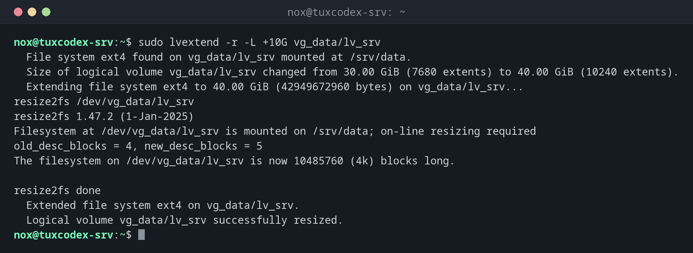

# lvextend

> Vergrößert ein logisches Volume, mit `-r` auch das Dateisystem darauf, während der Server weiterläuft.



## Syntax

```bash
lvextend [OPTION]... LV [PV]
```

## Optionen

| Option | Beschreibung |
|--------|--------------|
| `-L +GRÖSSE` | Um diesen Betrag vergrößern, z. B. `+10G` |
| `-L GRÖSSE` | Auf diese Gesamtgröße vergrößern, z. B. `40G` |
| `-l +100%FREE` | Den ganzen freien Platz der Volume Group nutzen |
| `-r` | Auch das Dateisystem vergrößern (ruft `resize2fs` oder `xfs_growfs` auf) |

## Beispiele

**Volume und Dateisystem um 10 GiB vergrößern:**

```bash
sudo lvextend -r -L +10G vg_data/lv_srv
```

```text
  File system ext4 found on vg_data/lv_srv mounted at /srv/data.
  Size of logical volume vg_data/lv_srv changed from 30.00 GiB (7680 extents) to 40.00 GiB (10240 extents).
  Extending file system ext4 to 40.00 GiB (42949672960 bytes) on vg_data/lv_srv...
resize2fs /dev/vg_data/lv_srv
resize2fs 1.47.2 (1-Jan-2025)
Filesystem at /dev/vg_data/lv_srv is mounted on /srv/data; on-line resizing required
old_desc_blocks = 4, new_desc_blocks = 5
The filesystem on /dev/vg_data/lv_srv is now 10485760 (4k) blocks long.

resize2fs done
  Extended file system ext4 on vg_data/lv_srv.
  Logical volume vg_data/lv_srv successfully resized.
```

**Das Ergebnis prüfen:**

```bash
df -h /srv/data
```

```text
Filesystem                  Size  Used Avail Use% Mounted on
/dev/mapper/vg_data-lv_srv   40G  6.8G   31G  19% /srv/data
```

**Zu wenig freier Platz in der Volume Group:**

```bash
sudo lvextend -r -L +30G vg_data/lv_srv
```

```text
  Insufficient free space: 7680 extents needed, but only 2559 available
```

Füge mit [`vgextend`](vgs.md) eine Platte hinzu und versuche es erneut.

## Wann brauche ich das?

- Wenn ein Volume vollläuft und die Volume Group freien Platz hat
- Nachdem du der Volume Group mit `vgextend` eine Platte hinzugefügt hast
- Als schnelle Hilfe bei `No space left on device`, ohne Ausfallzeit

!!! tip "Immer `-r` nutzen"
    Ohne `-r` wächst nur das Volume, und `df` zeigt weiter die alte Größe. Dann musst du
    [`resize2fs`](resize2fs.md) oder [`xfs_growfs`](xfs_growfs.md) selbst ausführen.

!!! warning "Verkleinern ist riskant"
    `lvreduce` gibt es, aber Verkleinern kostet Daten, wenn das Dateisystem nicht vorher
    verkleinert wird. XFS lässt sich gar nicht verkleinern. Plane die Größen so, dass du nur
    vergrößern musst.

## Verwandte Befehle

[lvs](lvs.md) · [vgs](vgs.md) · [resize2fs](resize2fs.md) · [xfs_growfs](xfs_growfs.md)
