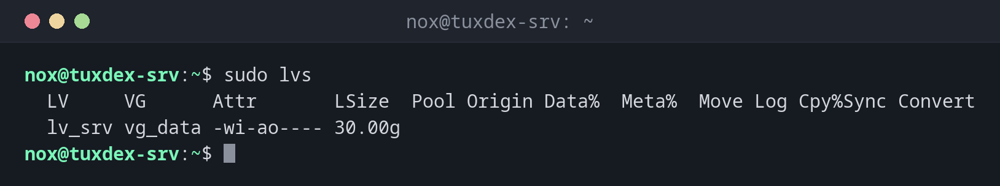

# lvs

> Lists the logical volumes of LVM: the volumes that carry the file systems, with their size and state.



## Syntax

```bash
lvs [OPTION]... [VG | LV]...
```

## Options

| Option | Description |
|--------|-------------|
| *(none)* | All logical volumes |
| `-o FIELDS` | Choose columns, e.g. `lv_name,lv_size,devices` |
| `-a` | Also internal volumes, e.g. of snapshots or RAID |
| `lvdisplay LV` | Detailed information about a logical volume |

## Examples

**Show the logical volumes:**

```bash
sudo lvs
```

```text
  LV     VG      Attr       LSize  Pool Origin Data%  Meta%  Move Log Cpy%Sync Convert
  lv_srv vg_data -wi-ao---- 30.00g
```

**Show on which disk the volume is:**

```bash
sudo lvs -o lv_name,vg_name,lv_attr,lv_size,devices
```

```text
  LV     VG      Attr       LSize  Devices
  lv_srv vg_data -wi-ao---- 30.00g /dev/sdc(0)
```

**Details of a logical volume:**

```bash
sudo lvdisplay vg_data/lv_srv
```

```text
  --- Logical volume ---
  LV Path                /dev/vg_data/lv_srv
  LV Name                lv_srv
  VG Name                vg_data
  LV UUID                9ciwx5-BCQV-RnST-pBr7-eGxZ-SLBE-Jaz9dm
  LV Write Access        read/write
  LV Creation host, time tuxdex-srv, 2026-09-18 09:41:22 +0200
  LV Status              available
  # open                 1
  LV Size                30.00 GiB
  Current LE             7680
  Segments               1
  Allocation             inherit
  Read ahead sectors     auto
```

`LV Path` is the device you format and mount, `Current LE` the number of 4 MiB extents.

## When do I need it?

- To see which logical volumes exist and how large they are
- Before `lvextend`, to check the current size
- To find out on which disks a volume is stored

!!! tip "The attribute `-wi-ao----`"
    `w` writable, `i` inherited allocation, `a` active, `o` open, which means mounted or in
    use. A volume without `o` isn't mounted.

## Related commands

[lvcreate](lvcreate.md) · [lvextend](lvextend.md) · [vgs](vgs.md)
