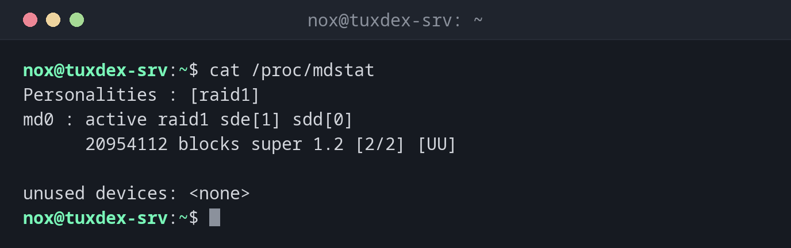

# mdadm

> Creates and manages software RAID arrays: mirror disks, check the state and replace a failed disk.



## Syntax

```bash
mdadm --create /dev/mdN --level=LEVEL --raid-devices=N DEVICE...
mdadm --detail /dev/mdN
mdadm /dev/mdN --fail | --remove | --add DEVICE
```

## Options

| Option | Description |
|--------|-------------|
| `--create`, `-C` | Create a new array |
| `--level=`, `-l` | RAID level: `1`, `5`, `6`, `10` or `0` |
| `--raid-devices=`, `-n` | Number of active disks in the array |
| `--detail`, `-D` | Show state, disks and UUID of an array |
| `--detail --scan` | One `ARRAY` line per array, for `mdadm.conf` |
| `--fail`, `--remove`, `--add` | Mark a disk as failed, take it out, add a new one |
| `--examine`, `-E` | Show the RAID superblock on a single disk |
| `--zero-superblock` | Delete the RAID superblock from a disk that is no longer used |

The kernel shows the state of all arrays in `/proc/mdstat`. `[UU]` means all disks are up, `[U_]` that one is missing.

## Examples

**The state of all arrays:**

```bash
cat /proc/mdstat
```

```text
Personalities : [raid1]
md0 : active raid1 sde[1] sdd[0]
      20954112 blocks super 1.2 [2/2] [UU]

unused devices: <none>
```

**Mirror two new disks (RAID 1):**

```bash
sudo mdadm --create /dev/md0 --level=1 --raid-devices=2 /dev/sdd /dev/sde
```

```text
mdadm: Note: this array has metadata at the start and
    may not be suitable as a boot device.  If you plan to
    store '/boot' on this device please ensure that
    your boot-loader understands md/v1.x metadata, or use
    --metadata=0.90
mdadm: size set to 20954112K
Continue creating array? y
mdadm: Defaulting to version 1.2 metadata
mdadm: array /dev/md0 started.
```

The array is usable right away. In the background the kernel copies the first disk to the second; `/proc/mdstat` shows the progress. Then create a file system with `sudo mkfs.ext4 /dev/md0`.

**Details of an array:**

```bash
sudo mdadm --detail /dev/md0
```

```text
/dev/md0:
           Version : 1.2
     Creation Time : Mon Oct 26 10:42:17 2026
        Raid Level : raid1
        Array Size : 20954112 (19.98 GiB 21.46 GB)
     Used Dev Size : 20954112 (19.98 GiB 21.46 GB)
      Raid Devices : 2
     Total Devices : 2
       Persistence : Superblock is persistent

       Update Time : Mon Oct 26 10:44:03 2026
             State : clean
    Active Devices : 2
   Working Devices : 2
    Failed Devices : 0
     Spare Devices : 0

Consistency Policy : resync

              Name : tuxdex-srv:0  (local to host tuxdex-srv)
              UUID : 3f8a2c1e:9b47d6a0:5e21c8f4:7d03b9e2
            Events : 17

    Number   Major   Minor   RaidDevice State
       0       8       48        0      active sync   /dev/sdd
       1       8       64        1      active sync   /dev/sde
```

**Save the array, so it gets the same name at boot:**

```bash
sudo mdadm --detail --scan | sudo tee -a /etc/mdadm/mdadm.conf
sudo update-initramfs -u
```

```text
ARRAY /dev/md0 metadata=1.2 name=tuxdex-srv:0 UUID=3f8a2c1e:9b47d6a0:5e21c8f4:7d03b9e2
update-initramfs: Generating /boot/initrd.img-6.12.48+deb13-amd64
```

**A disk has failed:**

```bash
cat /proc/mdstat
```

```text
Personalities : [raid1]
md0 : active raid1 sde[1](F) sdd[0]
      20954112 blocks super 1.2 [2/1] [U_]

unused devices: <none>
```

`(F)` marks the failed disk, `[U_]` shows that the array runs on one disk only. The data is still there.

**Take out the failed disk and add the new one:**

```bash
sudo mdadm /dev/md0 --remove /dev/sde
# swap the disk, then:
sudo mdadm /dev/md0 --add /dev/sde
cat /proc/mdstat
```

```text
mdadm: hot removed /dev/sde from /dev/md0
mdadm: added /dev/sde
Personalities : [raid1]
md0 : active raid1 sde[2] sdd[0]
      20954112 blocks super 1.2 [2/1] [U_]
      [====>................]  recovery = 23.6% (4946304/20954112) finish=1.3min speed=203472K/sec

unused devices: <none>
```

During the `recovery` the array stays usable. When it's done, `/proc/mdstat` shows `[UU]` again.

## When do I need it?

- To mirror two data disks, so the server keeps running when one of them fails
- To check the state of an array after a warning mail or in a monitoring script
- To swap a failed disk and rebuild the array

!!! tip "Get mails about failed disks"
    The service `mdmonitor` watches all arrays and mails the address from `MAILADDR` in
    `mdadm.conf`. A test: `sudo mdadm --monitor --scan --test --oneshot` sends a test mail
    for every array.

!!! warning "RAID is not a backup"
    A mirror protects against a failed disk, not against `rm -rf`, ransomware or a broken
    file system: those are mirrored right away. You still need a backup.

!!! danger "`--create` overwrites the disks"
    `mdadm --create` writes new superblocks to the named disks. Check the device names with
    `lsblk` first: a wrong letter destroys the data on another disk.

## Distribution differences

| | Debian | Ubuntu | RHEL | Arch |
|---|--------|--------|------|------|
| Install | `sudo apt install mdadm` | preinstalled on Ubuntu Server | `sudo dnf install mdadm` | `sudo pacman -S mdadm` |
| Configuration file | `/etc/mdadm/mdadm.conf` | `/etc/mdadm/mdadm.conf` | `/etc/mdadm.conf` | `/etc/mdadm.conf` |
| Update the initramfs | `update-initramfs -u` | `update-initramfs -u` | `dracut -f` | `mkinitcpio -P` (hook `mdadm_udev`) |

## Related commands

[lsblk](lsblk.md) · [mkfs](mkfs.md) · [mount](mount.md) · [smartctl](smartctl.md) · [pvs](pvs.md)
