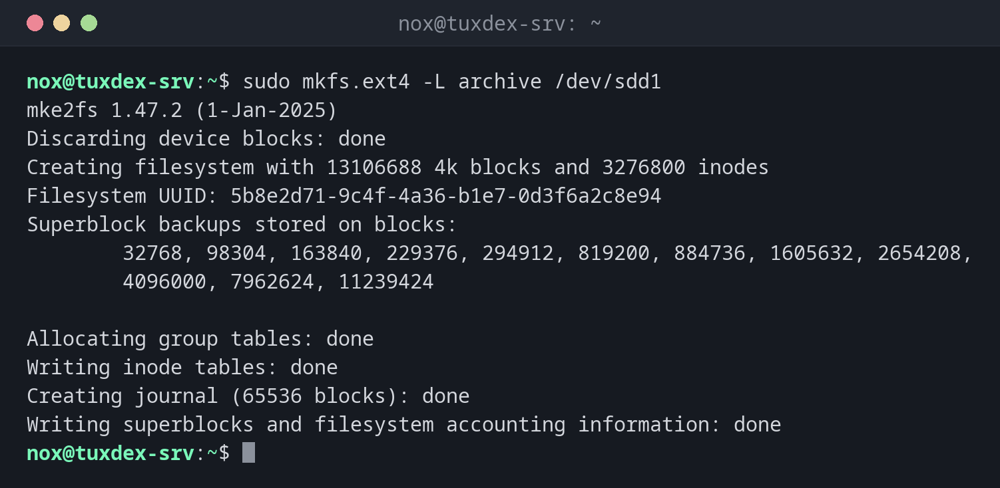

# mkfs

> Creates a file system on a partition or volume, in other words: formats it. `mkfs.ext4`, `mkfs.xfs` and others are the variants for each file system.



## Syntax

```bash
mkfs.TYPE [OPTION]... DEVICE
```

## Options

| Option | Description |
|--------|-------------|
| `mkfs.ext4 DEVICE` | Create an ext4 file system |
| `mkfs.xfs DEVICE` | Create an XFS file system |
| `-L LABEL` | Give the file system a name |
| `-m 1` | ext4: reserve only 1 % for root instead of 5 % (useful for data disks) |
| `-f` | XFS: overwrite an existing file system |
| `-n` | ext4: only show what would be done |

## Examples

**Create an ext4 file system with a label:**

```bash
sudo mkfs.ext4 -L archive /dev/sdd1
```

```text
mke2fs 1.47.2 (1-Jan-2025)
Discarding device blocks: done
Creating filesystem with 13106688 4k blocks and 3276800 inodes
Filesystem UUID: 5b8e2d71-9c4f-4a36-b1e7-0d3f6a2c8e94
Superblock backups stored on blocks:
        32768, 98304, 163840, 229376, 294912, 819200, 884736, 1605632, 2654208,
        4096000, 7962624, 11239424

Allocating group tables: done
Writing inode tables: done
Creating journal (65536 blocks): done
Writing superblocks and filesystem accounting information: done
```

**Create an XFS file system (the default on RHEL):**

```bash
sudo mkfs.xfs -L archive /dev/sdd1
```

```text
meta-data=/dev/sdd1              isize=512    agcount=4, agsize=3276672 blks
         =                       sectsz=512   attr=2, projid32bit=1
         =                       crc=1        finobt=1, sparse=1, rmapbt=1
         =                       reflink=1    bigtime=1 inobtcount=1 nrext64=1
         =                       exchange=0   metadir=0
data     =                       bsize=4096   blocks=13106688, imaxpct=25
         =                       sunit=0      swidth=0 blks
naming   =version 2              bsize=4096   ascii-ci=0, ftype=1, parent=0
log      =internal log           bsize=4096   blocks=16384, version=2
         =                       sectsz=512   sunit=0 blks, lazy-count=1
realtime =none                   extsz=4096   blocks=0, rtextents=0
         =                       rgcount=0    rgsize=0 extents
Discarding blocks...Done.
```

**Protection against formatting the wrong partition:**

```bash
sudo mkfs.ext4 /dev/sdb1
```

```text
mke2fs 1.47.2 (1-Jan-2025)
/dev/sdb1 contains a ext4 file system labelled 'backup'
        last mounted on /mnt/backup on Mon Oct 26 03:00:12 2026
Proceed anyway? (y,N) n
```

`/dev/sdb1` is the backup disk. Answering `n` saved the data.

## When do I need it?

- After partitioning a new disk, before mounting it
- For a new logical volume of LVM
- To empty a data disk completely and start over

!!! tip "Check after formatting"
    [`blkid`](blkid.md) shows the new UUID. You need it for the line in `/etc/fstab`.

!!! danger "Formatting deletes everything"
    `mkfs` destroys all data on the device, without a backup and without undo. ext4 asks if
    it finds an existing file system, XFS refuses without `-f`. Take these warnings
    seriously.

## Distribution differences

| | Debian | Ubuntu | RHEL | Arch |
|---|--------|--------|------|------|
| ext4 tools | `e2fsprogs`, installed | `e2fsprogs`, installed | `e2fsprogs`, installed | `e2fsprogs`, installed |
| XFS tools | `xfsprogs`, not installed | `xfsprogs`, installed | `xfsprogs`, installed | `xfsprogs`, not installed |

## Related commands

[fdisk](fdisk.md) · [blkid](blkid.md) · [mount](mount.md) · [mkswap](mkswap.md) · [xfs_growfs](xfs_growfs.md) · [lvcreate](lvcreate.md)
