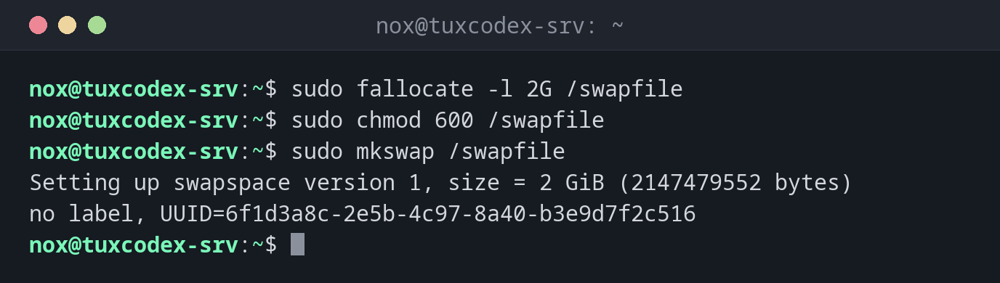

# mkswap

> Prepares a partition or a file as swap space, the area Linux uses when memory runs short.



## Syntax

```bash
mkswap [OPTION]... DEVICE | FILE
```

After `mkswap`, the swap space is ready but not yet in use. [`swapon`](swapon.md) activates it.

## Options

| Option | Description |
|--------|-------------|
| `-L LABEL` | Give the swap area a name |
| `-U UUID` | Set a specific UUID |
| `--file FILE -s SIZE` | Create the swap file and prepare it in one step (newer util-linux) |

## Examples

**Create a swap file of 2 GiB:**

```bash
sudo fallocate -l 2G /swapfile
sudo chmod 600 /swapfile
sudo mkswap /swapfile
```

```text
Setting up swapspace version 1, size = 2 GiB (2147479552 bytes)
no label, UUID=6f1d3a8c-2e5b-4c97-8a40-b3e9d7f2c516
```

**Prepare a swap partition with a label:**

```bash
sudo mkswap -L swap /dev/sda3
```

```text
mkswap: /dev/sda3: warning: wiping old swap signature.
Setting up swapspace version 1, size = 1024 MiB (1073737728 bytes)
LABEL=swap, UUID=8e2b6d4f-1a3c-4f5e-b7d9-0c2e4a6f8b31
```

**Make the swap file permanent:**

```bash
echo '/swapfile none swap sw 0 0' | sudo tee -a /etc/fstab
```

```text
/swapfile none swap sw 0 0
```

## When do I need it?

- When a server has too little memory and no swap at all
- To add a swap file to a cloud server without changing partitions
- After replacing or resizing the swap partition

!!! tip "Swap file instead of partition"
    A swap file can be created, enlarged and removed at any time, without touching the
    partitions. For most servers, that's the more flexible choice.

!!! warning "Permissions of the swap file"
    A swap file must only be readable by root (`chmod 600`). Otherwise other users could
    read memory contents, `mkswap` warns about insecure permissions.

## Related commands

[swapon](swapon.md) · [free](../08-processes/free.md) · [mkfs](mkfs.md)
