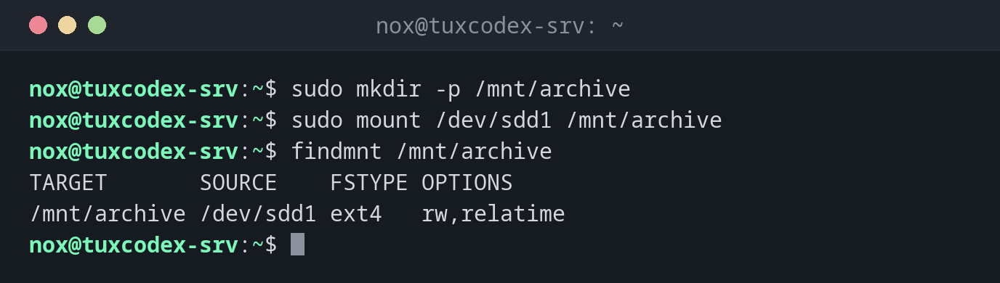

# mount

> Hängt ein Dateisystem in den Verzeichnisbaum ein, damit seine Dateien in einem Verzeichnis erscheinen. Ohne Argumente listet es auf, was eingehängt ist.



## Syntax

```bash
mount [OPTION]... [GERÄT] [EINHÄNGEPUNKT]
```

Der Einhängepunkt muss ein vorhandenes Verzeichnis sein. Dateien, die vorher darin lagen, sind verdeckt, solange dort etwas eingehängt ist.

## Optionen

| Option | Beschreibung |
|--------|--------------|
| `-a` | Alles aus `/etc/fstab` einhängen, was noch nicht eingehängt ist |
| `-t TYP` | Dateisystemtyp, meist automatisch erkannt |
| `-o OPTIONEN` | Optionen, z. B. `ro`, `noexec`, `remount` |
| `-o remount,ro` | Ein eingehängtes Dateisystem auf nur lesen umschalten |
| `-o loop` | Eine Image-Datei einhängen, z. B. ein ISO |

## Beispiele

**Eine neue Partition einhängen:**

```bash
sudo mkdir -p /mnt/archive
sudo mount /dev/sdd1 /mnt/archive
findmnt /mnt/archive
```

```text
TARGET       SOURCE    FSTYPE OPTIONS
/mnt/archive /dev/sdd1 ext4   rw,relatime
```

**Alle Einträge aus `/etc/fstab` testen:**

```bash
sudo mount -a
```

```text
mount: /mnt/archive: can't find UUID=5b8e2d71-9c4f-4a36-b1e7-0d3f6a2c8e94.
```

Ein Tippfehler in der UUID. Ohne diesen Test wäre der Server beim nächsten Booten stehen
geblieben.

**Ein Dateisystem auf nur lesen umschalten:**

```bash
sudo mount -o remount,ro /mnt/backup
findmnt /mnt/backup
```

```text
TARGET      SOURCE    FSTYPE OPTIONS
/mnt/backup /dev/sdb1 ext4   ro,relatime
```

**Eine ISO-Datei einhängen:**

```bash
sudo mount -o loop debian-13.1.0-amd64-netinst.iso /mnt/iso
```

```text
mount: /mnt/iso: WARNING: source write-protected, mounted read-only.
```

**Der falsche Dateisystemtyp:**

```bash
sudo mount -t xfs /dev/sdd1 /mnt/archive
```

```text
mount: /mnt/archive: wrong fs type, bad option, bad superblock on /dev/sdd1, missing codepage or helper program, or other error.
       dmesg(1) may have more information after failed mount system call.
```

`/dev/sdd1` enthält ext4, nicht XFS. Lass `-t` weg, `mount` erkennt den Typ selbst.

## Wann brauche ich das?

- Um eine neue Platte nach dem Formatieren zu nutzen
- Um eine neue Zeile in `/etc/fstab` mit `mount -a` zu testen
- Um eine ISO-Datei oder eine Rettungsplatte einzuhängen

!!! tip "Dauerhafte Einhängungen gehören in `/etc/fstab`"
    `mount` gilt nur bis zum nächsten Neustart. Für dauerhafte Einhängungen trägst du eine
    Zeile mit der UUID in `/etc/fstab` ein, siehe [Grundlagen](basics.md), und testest sie
    mit `sudo mount -a`.

!!! warning "`nofail` für zusätzliche Platten"
    Ohne `nofail` in `/etc/fstab` hält eine fehlende oder defekte Datenplatte den
    Bootvorgang an. Mit `nofail` startet der Server trotzdem, und du kannst es über SSH
    beheben.

## Verwandte Befehle

[umount](umount.md) · [findmnt](findmnt.md) · [blkid](blkid.md) · [df](df.md)
