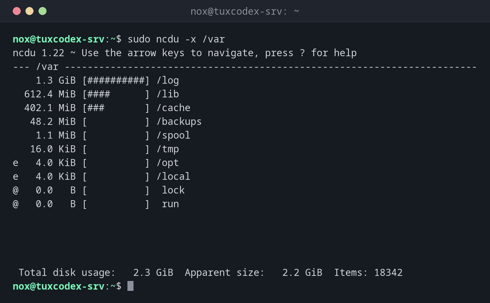

# ncdu

> An interactive version of `du`: shows the largest directories as a list with bars, lets you browse into them and delete files directly.



## Syntax

```bash
ncdu [OPTION]... [DIRECTORY]
```

## Options

| Option | Description |
|--------|-------------|
| `-x` | Stay on this file system |
| `-o FILE` | Scan and save the result to a file |
| `-f FILE` | Show a saved scan |
| `--exclude PATTERN` | Skip matching files and directories |
| `-r` | Read only: deleting is disabled |

Keys inside `ncdu`: ++arrow-up++ ++arrow-down++ select, ++enter++ open a directory, ++arrow-left++ go back, ++d++ delete, ++g++ toggle the bars, ++q++ quit.

## Examples

**Analyse a directory:**

```bash
sudo ncdu -x /var
```

```text
ncdu 1.22 ~ Use the arrow keys to navigate, press ? for help
--- /var ------------------------------------------------------------------------
    1.3 GiB [##########] /log
  612.4 MiB [####      ] /lib
  402.1 MiB [###       ] /cache
   48.2 MiB [          ] /backups
    1.1 MiB [          ] /spool
   16.0 KiB [          ] /tmp
e   4.0 KiB [          ] /opt
e   4.0 KiB [          ] /local
@   0.0   B [          ]  lock
@   0.0   B [          ]  run


 Total disk usage:   2.3 GiB  Apparent size:   2.2 GiB  Items: 18342
```

`e` marks empty directories, `@` symbolic links.

**Browse into a directory with ++enter++:**

```bash
sudo ncdu /var/log/nginx
```

```text
ncdu 1.22 ~ Use the arrow keys to navigate, press ? for help
--- /var/log/nginx --------------------------------------------------------------
/..
    4.0 GiB [##########]  access.log.1
    1.0 GiB [##        ]  access.log
   48.1 MiB [          ]  error.log
    3.2 MiB [          ]  access.log.2.gz


 Total disk usage:   5.1 GiB  Apparent size:   5.1 GiB  Items: 5
```

An old log of 4 GiB that logrotate didn't compress. A good candidate for deleting.

**Save a scan and open it later:**

```bash
sudo ncdu -x -o /tmp/root.ncdu /
ls -lh /tmp/root.ncdu
```

```text
-rw-r--r-- 1 root root 3.1M Oct 26 10:42 /tmp/root.ncdu
```

## When do I need it?

- When a disk is full and you want to find the cause quickly
- To clean up interactively: browse into the large directories and delete old files
- On servers where you need the result again later: scan once with `-o`

!!! tip "Scan once, look later"
    `sudo ncdu -x -o /tmp/root.ncdu /` scans in the background. `ncdu -f /tmp/root.ncdu`
    opens the result as often as you like, without scanning again.

!!! warning "Deleting with ++d++"
    `ncdu` asks before deleting, but it deletes for real. With `sudo`, it can also delete
    system files. Use `-r` if you only want to look.

## Distribution differences

| | Debian | Ubuntu | RHEL | Arch |
|---|--------|--------|------|------|
| Installed by default | no, `sudo apt install ncdu` | no, `sudo apt install ncdu` | no, from EPEL | no, `sudo pacman -S ncdu` |

## Related commands

[du](du.md) · [df](df.md)
