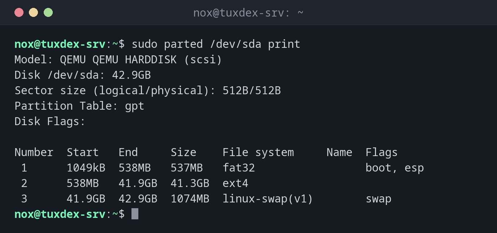

# parted

> Creates, changes and grows partitions, also in a single command line. Better suited for scripts than `fdisk`.



## Syntax

```bash
parted [OPTION]... DEVICE [COMMAND [ARGUMENT]...]
```

Unlike `fdisk`, `parted` writes every change **immediately**, there is no `w` at the end.

## Options

| Option | Description |
|--------|-------------|
| `print` | Show the partition table |
| `mklabel gpt` | Create a new, empty GPT table |
| `mkpart NAME FS START END` | Create a partition, e.g. `data ext4 1MiB 100%` |
| `resizepart N END` | Move the end of partition `N`, e.g. to `100%` |
| `rm N` | Delete partition `N` |
| `unit MiB` | Show and enter sizes in MiB |
| `-s` | Script mode: no questions |

## Examples

**Show the partitions of the system disk:**

```bash
sudo parted /dev/sda print
```

```text
Model: QEMU QEMU HARDDISK (scsi)
Disk /dev/sda: 42.9GB
Sector size (logical/physical): 512B/512B
Partition Table: gpt
Disk Flags:

Number  Start   End     Size    File system     Name  Flags
 1      1049kB  538MB   537MB   fat32                 boot, esp
 2      538MB   41.9GB  41.3GB  ext4
 3      41.9GB  42.9GB  1074MB  linux-swap(v1)        swap
```

**Partition a new disk in one line:**

```bash
sudo parted -s /dev/sdd mklabel gpt mkpart data ext4 1MiB 100%
sudo parted /dev/sdd print
```

```text
Model: QEMU QEMU HARDDISK (scsi)
Disk /dev/sdd: 53.7GB
Sector size (logical/physical): 512B/512B
Partition Table: gpt
Disk Flags:

Number  Start   End     Size    File system  Name  Flags
 1      1049kB  53.7GB  53.7GB               data
```

The column `File system` stays empty: `ext4` in `mkpart` is only a hint, the file
system itself is created by [`mkfs`](mkfs.md).

**Show sizes in MiB:**

```bash
sudo parted /dev/sdd unit MiB print
```

```text
Model: QEMU QEMU HARDDISK (scsi)
Disk /dev/sdd: 51200MiB
Sector size (logical/physical): 512B/512B
Partition Table: gpt
Disk Flags:

Number  Start    End       Size      File system  Name  Flags
 1      1.00MiB  51199MiB  51198MiB               data
```

## When do I need it?

- To partition disks in scripts or automation
- To grow a partition after the virtual disk was enlarged
- For disks larger than 2 TiB that need GPT

!!! tip "Start at `1MiB`"
    `1MiB` as start and `100%` as end aligns the partition correctly for SSDs and RAID and
    uses the whole disk.

!!! danger "Changes are immediate"
    `mklabel` on a disk in use deletes its partition table at once, without a second
    question in script mode. Double check the device name.

## Related commands

[fdisk](fdisk.md) · [lsblk](lsblk.md) · [resize2fs](resize2fs.md) · [mkfs](mkfs.md)
