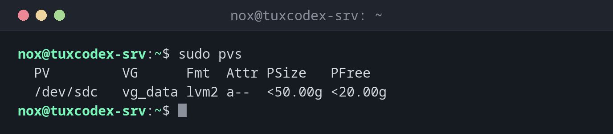

# pvs

> Listet die physischen Volumes von LVM: welche Platten zu welcher Volume Group gehören und wie viel Platz darauf noch frei ist. `pvcreate` macht eine Platte zu einem physischen Volume.



## Syntax

```bash
pvs [OPTION]... [PV]...
```

## Optionen

| Option | Beschreibung |
|--------|--------------|
| *(keine)* | Alle physischen Volumes mit Größe und freiem Platz |
| `-o +FELDER` | Zusätzliche Spalten, z. B. `+pv_used` |
| `pvdisplay PV` | Ausführliche Angaben zu einem physischen Volume |
| `pvcreate GERÄT` | Eine Platte oder Partition für LVM vorbereiten |

## Beispiele

**Die physischen Volumes anzeigen:**

```bash
sudo pvs
```

```text
  PV         VG      Fmt  Attr PSize   PFree
  /dev/sdc   vg_data lvm2 a--  <50.00g <20.00g
```

Das `<` heißt „etwas weniger als“: LVM behält etwas Platz für seine Metadaten.

**Eine neue Platte für LVM vorbereiten:**

```bash
sudo pvcreate /dev/sdd
sudo pvs
```

```text
  Physical volume "/dev/sdd" successfully created.
  PV         VG      Fmt  Attr PSize   PFree
  /dev/sdc   vg_data lvm2 a--  <50.00g <20.00g
  /dev/sdd           lvm2 ---   50.00g  50.00g
```

`/dev/sdd` gehört noch zu keiner Volume Group, siehe [`vgs`](vgs.md).

**Details eines physischen Volumes:**

```bash
sudo pvdisplay /dev/sdc
```

```text
  --- Physical volume ---
  PV Name               /dev/sdc
  VG Name               vg_data
  PV Size               50.00 GiB / not usable 4.00 MiB
  Allocatable           yes
  PE Size               4.00 MiB
  Total PE              12799
  Free PE               5119
  Allocated PE          7680
  PV UUID               Qm3T9x-2kPa-7HcR-dL4e-Vn8s-Wf1y-Z6bJ0u
```

## Wann brauche ich das?

- Um herauszufinden, welche Platten LVM nutzt
- Vor dem Erweitern einer Volume Group: Gibt es ein freies physisches Volume?
- Nach dem Hinzufügen einer Platte, um sie mit `pvcreate` vorzubereiten

!!! tip "Attribut `a--`"
    `a` heißt allocatable: LVM darf den Platz darauf nutzen. Ein physisches Volume ohne VG
    zeigt `---`.

## Unterschiede zwischen Distributionen

| | Debian | Ubuntu | RHEL | Arch |
|---|--------|--------|------|------|
| LVM-Werkzeuge installiert | nur bei einer LVM-Installation | ja | ja | nein, Paket `lvm2` |

## Verwandte Befehle

[vgs](vgs.md) · [lvs](lvs.md) · [lsblk](lsblk.md)
