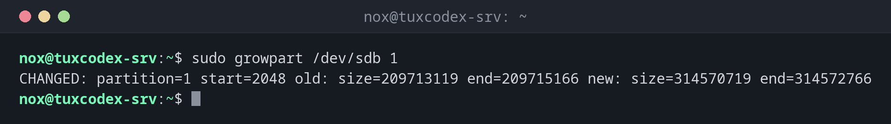

# resize2fs

> Grows or shrinks an ext4 file system. Growing even works while it is mounted and in use.



## Syntax

```bash
resize2fs [OPTION]... DEVICE [SIZE]
```

The partition or logical volume has to be enlarged first. `resize2fs` only adapts the file system to it.

## Options

| Option | Description |
|--------|-------------|
| *(no size)* | Grow the file system to the size of the partition or volume |
| `SIZE` | New size, e.g. `40G`, for shrinking |
| `-P` | Show the minimum size the file system can be shrunk to |
| `-p` | Show progress |

## Examples

**Grow the partition after the disk was enlarged to 150 GB:**

```bash
sudo growpart /dev/sdb 1
```

```text
CHANGED: partition=1 start=2048 old: size=209713119 end=209715166 new: size=314570719 end=314572766
```

`growpart` comes from the package `cloud-guest-utils` (Debian, Ubuntu) or
`cloud-utils-growpart` (RHEL). Note the space between disk and partition number.

**Grow the file system while it is mounted:**

```bash
sudo resize2fs /dev/sdb1
```

```text
resize2fs 1.47.2 (1-Jan-2025)
Filesystem at /dev/sdb1 is mounted on /mnt/backup; on-line resizing required
old_desc_blocks = 13, new_desc_blocks = 19
The filesystem on /dev/sdb1 is now 39321339 (4k) blocks long.
```

**Check the result:**

```bash
df -h /mnt/backup
```

```text
Filesystem      Size  Used Avail Use% Mounted on
/dev/sdb1       147G   32G  109G  23% /mnt/backup
```

**Find out how small it could become:**

```bash
sudo resize2fs -P /dev/sdd1
```

```text
resize2fs 1.47.2 (1-Jan-2025)
Estimated minimum size of the filesystem: 712355
```

The value is in blocks of 4 KiB, so about 2.7 GiB.

## When do I need it?

- After a virtual disk was enlarged by the hosting provider
- After `lvextend`, if you didn't use its option `-r`
- To shrink a file system before shrinking the partition (unmounted)

!!! tip "The order matters"
    Growing: first the partition or volume, then the file system. Shrinking: first the
    file system, then the partition. The wrong order loses data.

!!! warning "Shrinking only unmounted"
    ext4 can only be shrunk when it is not mounted, and only after `e2fsck -f`. That's why
    the root file system can only be shrunk from a rescue system.

## Related commands

[lvextend](lvextend.md) · [xfs_growfs](xfs_growfs.md) · [parted](parted.md) · [df](df.md)
