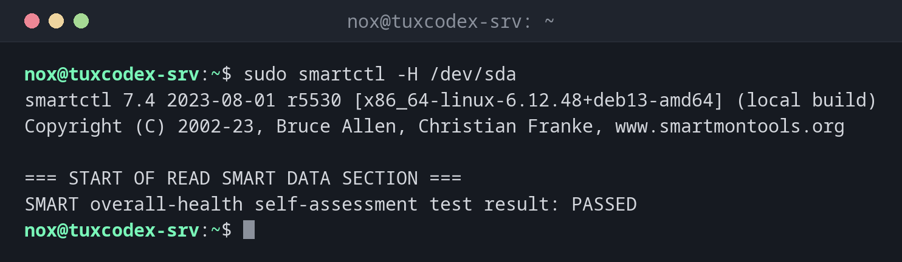

# smartctl

> Reads the self-monitoring data (S.M.A.R.T.) of hard disks and SSDs and starts self-tests. Warns early when a disk is about to fail.



## Syntax

```bash
smartctl [OPTION]... DEVICE
```

The package is called `smartmontools`. It also contains the service `smartd`, which checks the disks regularly and can send mail.

## Options

| Option | Description |
|--------|-------------|
| `-H` | Overall health: `PASSED` or `FAILED` |
| `-i` | Model, serial number, capacity |
| `-A` | The SMART attributes, e.g. reallocated sectors and temperature |
| `-a` | Everything at once |
| `-t short`, `-t long` | Start a short or a long self-test |
| `-l selftest` | Results of the last self-tests |

## Examples

**Check the overall health of a disk:**

```bash
sudo smartctl -H /dev/sda
```

```text
smartctl 7.4 2023-08-01 r5530 [x86_64-linux-6.12.48+deb13-amd64] (local build)
Copyright (C) 2002-23, Bruce Allen, Christian Franke, www.smartmontools.org

=== START OF READ SMART DATA SECTION ===
SMART overall-health self-assessment test result: PASSED
```

**Show model and serial number:**

```bash
sudo smartctl -i /dev/sda
```

```text
smartctl 7.4 2023-08-01 r5530 [x86_64-linux-6.12.48+deb13-amd64] (local build)
Copyright (C) 2002-23, Bruce Allen, Christian Franke, www.smartmontools.org

=== START OF INFORMATION SECTION ===
Model Family:     Samsung based SSDs
Device Model:     Samsung SSD 870 EVO 1TB
Serial Number:    S6PUNX0T812345K
User Capacity:    1,000,204,886,016 bytes [1.00 TB]
Rotation Rate:    Solid State Device
SMART support is: Available - device has SMART capability.
SMART support is: Enabled
```

**Show the most important attributes:**

```bash
sudo smartctl -A /dev/sda
```

```text
smartctl 7.4 2023-08-01 r5530 [x86_64-linux-6.12.48+deb13-amd64] (local build)
Copyright (C) 2002-23, Bruce Allen, Christian Franke, www.smartmontools.org

=== START OF READ SMART DATA SECTION ===
SMART Attributes Data Structure revision number: 1
Vendor Specific SMART Attributes with Thresholds:
ID# ATTRIBUTE_NAME          FLAG     VALUE WORST THRESH TYPE      UPDATED  WHEN_FAILED RAW_VALUE
  5 Reallocated_Sector_Ct   0x0033   100   100   010    Pre-fail  Always       -       0
  9 Power_On_Hours          0x0032   097   097   000    Old_age   Always       -       12842
 12 Power_Cycle_Count       0x0032   099   099   000    Old_age   Always       -       43
177 Wear_Leveling_Count     0x0013   098   098   000    Pre-fail  Always       -       21
194 Temperature_Celsius     0x0022   066   052   000    Old_age   Always       -       34
199 UDMA_CRC_Error_Count    0x003e   100   100   000    Old_age   Always       -       0
```

`RAW_VALUE` is the real value: 12842 operating hours, 34 °C, no reallocated sectors.

**Start a short self-test:**

```bash
sudo smartctl -t short /dev/sda
```

```text
smartctl 7.4 2023-08-01 r5530 [x86_64-linux-6.12.48+deb13-amd64] (local build)
Copyright (C) 2002-23, Bruce Allen, Christian Franke, www.smartmontools.org

=== START OF OFFLINE IMMEDIATE AND SELF-TEST SECTION ===
Sending command: "Execute SMART Short self-test routine immediately in off-line mode".
Drive command "Execute SMART Short self-test routine immediately in off-line mode" successful.
Testing has begun.
Please wait 2 minutes for test to complete.
Test will complete after Mon Oct 26 10:44:17 2026 CET
Use smartctl -X to abort test.
```

**On a virtual server:**

```bash
sudo smartctl -i /dev/sda
```

```text
smartctl 7.4 2023-08-01 r5530 [x86_64-linux-6.12.48+deb13-amd64] (local build)
Copyright (C) 2002-23, Bruce Allen, Christian Franke, www.smartmontools.org

=== START OF INFORMATION SECTION ===
Vendor:               QEMU
Product:              QEMU HARDDISK
Revision:             2.5+
User Capacity:        42,949,672,960 bytes [42.9 GB]
Logical block size:   512 bytes
Device type:          disk
Local Time is:        Mon Oct 26 10:42:17 2026 CET
SMART support is:     Unavailable - device lacks SMART capability.
```

## When do I need it?

- On physical servers, to notice failing disks before data is lost
- When a disk reports read errors in `journalctl -k`
- Before reusing an old disk

!!! tip "Watch these attributes"
    `Reallocated_Sector_Ct`, `Current_Pending_Sector` and `Offline_Uncorrectable` should be
    `0`. If they rise, replace the disk soon, even if the overall health still says `PASSED`.

!!! warning "Not on virtual servers"
    Virtual disks have no SMART data. On a VM or cloud server, the hosting provider monitors
    the physical disks.

## Related commands

[lsblk](lsblk.md) · [journalctl](../09-systemd/journalctl.md)
