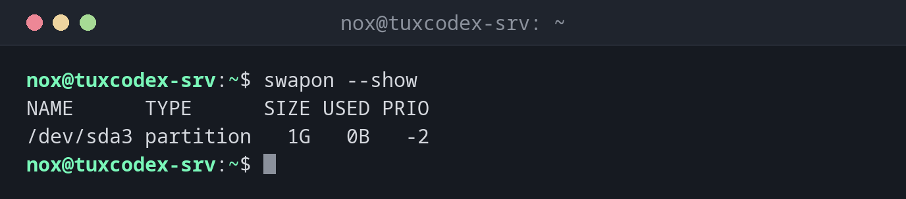

# swapon

> Aktiviert Swap-Partitionen und Swap-Dateien und zeigt, welche Swap-Bereiche genutzt werden. `swapoff` deaktiviert sie.



## Syntax

```bash
swapon [OPTION]... [GERÄT | DATEI]
```

## Optionen

| Option | Beschreibung |
|--------|--------------|
| `--show` | Die aktiven Swap-Bereiche mit Belegung und Priorität zeigen |
| `-a` | Alle Swap-Bereiche aus `/etc/fstab` aktivieren |
| `-p N` | Priorität: Höhere Zahlen werden zuerst genutzt |
| `swapoff GERÄT` | Einen Swap-Bereich deaktivieren |
| `swapoff -a` | Alle Swap-Bereiche deaktivieren |

## Beispiele

**Die aktiven Swap-Bereiche anzeigen:**

```bash
swapon --show
```

```text
NAME      TYPE      SIZE USED PRIO
/dev/sda3 partition   1G   0B   -2
```

**Eine neue Swap-Datei aktivieren:**

```bash
sudo swapon /swapfile
swapon --show
```

```text
NAME      TYPE      SIZE USED PRIO
/dev/sda3 partition   1G   0B   -2
/swapfile file        2G   0B   -3
```

Die Swap-Datei ist jetzt ebenfalls aktiv. Die Partition hat die höhere Priorität (`-2` ist
höher als `-3`) und wird zuerst genutzt.

**Die Swap-Datei wieder deaktivieren:**

```bash
sudo swapoff /swapfile
swapon --show
```

```text
NAME      TYPE      SIZE USED PRIO
/dev/sda3 partition   1G   0B   -2
```

## Wann brauche ich das?

- Nach `mkswap`, um den neuen Swap zu nutzen
- Um zu prüfen, wie viel Swap belegt ist und auf welchem Bereich
- Bevor du eine Swap-Datei entfernst oder vergrößerst

!!! tip "Nach einer Änderung an `/etc/fstab` prüfen"
    `sudo swapon -a` aktiviert alles aus `/etc/fstab`. Meldet es keinen Fehler, ist die Zeile
    richtig und funktioniert auch nach einem Neustart.

!!! warning "`swapoff` braucht freien Arbeitsspeicher"
    `swapoff` holt alles aus dem Swap zurück in den Arbeitsspeicher. Ist zu wenig frei,
    scheitert es, oder der OOM-Killer beendet Prozesse. Prüfe vorher mit
    [`free`](../08-processes/free.md).

## Verwandte Befehle

[mkswap](mkswap.md) · [free](../08-processes/free.md) · [top](../08-processes/top.md)
