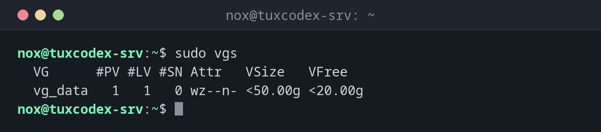

# vgs

> Lists the volume groups of LVM: the pools of storage that logical volumes are taken from. `vgcreate` creates one, `vgextend` adds disks to it.



## Syntax

```bash
vgs [OPTION]... [VG]...
```

## Options

| Option | Description |
|--------|-------------|
| *(none)* | All volume groups with size and free space |
| `vgcreate VG PV...` | Create a volume group from physical volumes |
| `vgextend VG PV` | Add a physical volume to a volume group |
| `vgdisplay VG` | Detailed information about a volume group |

## Examples

**Show the volume groups:**

```bash
sudo vgs
```

```text
  VG      #PV #LV #SN Attr   VSize   VFree
  vg_data   1   1   0 wz--n- <50.00g <20.00g
```

**Add a new disk to the volume group:**

```bash
sudo vgextend vg_data /dev/sdd
sudo vgs
```

```text
  Volume group "vg_data" successfully extended
  VG      #PV #LV #SN Attr   VSize  VFree
  vg_data   2   1   0 wz--n- 99.99g 69.99g
```

The group now has two disks and almost 70 GiB free.

**Create a new volume group:**

```bash
sudo vgcreate vg_backup /dev/sde
```

```text
  Volume group "vg_backup" successfully created
```

## When do I need it?

- To see how much space is left for new or larger logical volumes
- When `lvextend` reports too little free space: extend the group with a new disk
- When setting up LVM on a new server

!!! tip "The columns"
    `#PV` physical volumes, `#LV` logical volumes, `#SN` snapshots, `VFree` space that isn't
    assigned to any logical volume yet.

## Related commands

[pvs](pvs.md) · [lvs](lvs.md) · [lvcreate](lvcreate.md)
