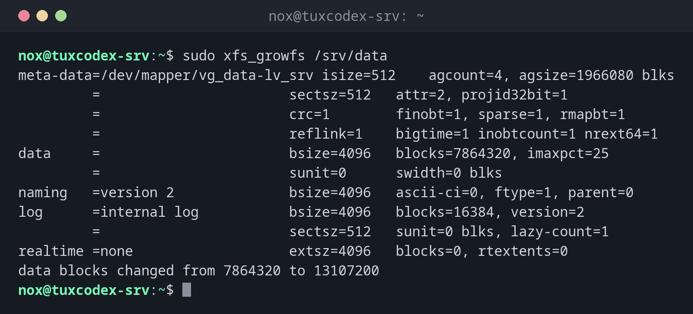

# xfs_growfs

> Grows an XFS file system to the size of its partition or volume, while it is mounted. XFS can't be shrunk.



## Syntax

```bash
xfs_growfs [OPTION]... MOUNTPOINT
```

Unlike `resize2fs`, `xfs_growfs` works on the **mount point**: the file system must be mounted.

## Options

| Option | Description |
|--------|-------------|
| *(none)* | Grow to the full size of the device |
| `-D BLOCKS` | Grow to this number of blocks |
| `-n` | Only show the current geometry, change nothing |

## Examples

**Grow an XFS file system after `lvextend`:**

```bash
sudo xfs_growfs /srv/data
```

```text
meta-data=/dev/mapper/vg_data-lv_srv isize=512    agcount=4, agsize=1966080 blks
         =                       sectsz=512   attr=2, projid32bit=1
         =                       crc=1        finobt=1, sparse=1, rmapbt=1
         =                       reflink=1    bigtime=1 inobtcount=1 nrext64=1
data     =                       bsize=4096   blocks=7864320, imaxpct=25
         =                       sunit=0      swidth=0 blks
naming   =version 2              bsize=4096   ascii-ci=0, ftype=1, parent=0
log      =internal log           bsize=4096   blocks=16384, version=2
         =                       sectsz=512   sunit=0 blks, lazy-count=1
realtime =none                   extsz=4096   blocks=0, rtextents=0
data blocks changed from 7864320 to 13107200
```

From 30 GiB (7864320 blocks of 4 KiB) to 50 GiB.

**Check the result:**

```bash
df -hT /srv/data
```

```text
Filesystem                 Type  Size  Used Avail Use% Mounted on
/dev/mapper/vg_data-lv_srv xfs    50G  7.2G   43G  15% /srv/data
```

**A file system that isn't mounted:**

```bash
sudo xfs_growfs /dev/sdd1
```

```text
xfs_growfs: /dev/sdd1 is not a mounted XFS filesystem
```

`/dev/sdd1` isn't mounted, and it contains ext4. `xfs_growfs` only works on mounted XFS
file systems.

## When do I need it?

- On RHEL, Rocky and Alma, where XFS is the default file system
- After `lvextend` or after enlarging a partition
- When an XFS volume is running full

!!! tip "`lvextend -r` does it for you"
    [`lvextend -r`](lvextend.md) grows the logical volume and calls `xfs_growfs` itself.

!!! warning "XFS can only grow"
    An XFS file system can't be made smaller. If you might need the space for something
    else later, grow it in small steps.

## Distribution differences

| | Debian | Ubuntu | RHEL | Arch |
|---|--------|--------|------|------|
| XFS tools installed | no, package `xfsprogs` | yes | yes | no, package `xfsprogs` |

## Related commands

[resize2fs](resize2fs.md) · [lvextend](lvextend.md) · [mkfs](mkfs.md) · [df](df.md)
