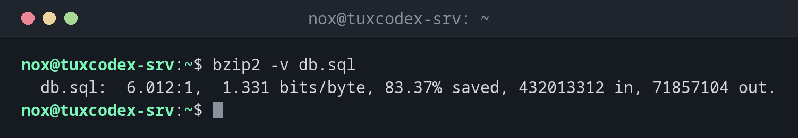

# bzip2

> Compresses files more strongly than gzip, but more slowly. Today mostly found in older archives.



## Syntax

```bash
bzip2 [OPTION]... [FILE]...
```

## Options

| Option | Description |
|--------|-------------|
| `-k` | Keep the original file |
| `-d`, `bunzip2` | Decompress |
| `-v` | Show the compression ratio |
| `-t` | Test a compressed file |
| `-1` … `-9` | Block size, default `9` |

## Examples

**Compress a file:**

```bash
bzip2 -v db.sql
```

```text
  db.sql:  6.012:1,  1.331 bits/byte, 83.37% saved, 432013312 in, 71857104 out.
```

**Test a compressed file:**

```bash
bzip2 -tv db.sql.bz2
```

```text
  db.sql.bz2: ok
```

**Unpack an old `.tar.bz2` archive:**

```bash
tar -xjvf site-2019.tar.bz2
```

```text
site-2019/
site-2019/index.php
site-2019/config.php
```

## When do I need it?

- To unpack older archives and downloads in `.bz2` format
- When an existing script or system expects bzip2

!!! tip "Better alternatives"
    For new archives, `zstd` is much faster with similar size, and `xz` compresses even
    stronger. bzip2 rarely has an advantage today.

## Related commands

[gzip](gzip.md) · [xz](xz.md) · [zstd](zstd.md) · [tar](tar.md)
