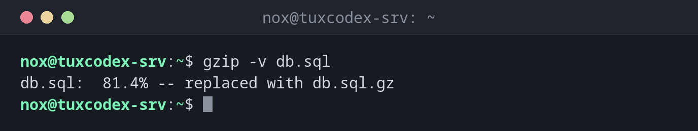

# gzip

> Komprimiert einzelne Dateien schnell und ersetzt sie durch eine `.gz`-Datei. Die verbreitetste Kompression unter Linux.



## Syntax

```bash
gzip [OPTION]... [DATEI]...
```

## Optionen

| Option | Beschreibung |
|--------|--------------|
| `-k` | Die Originaldatei behalten |
| `-d`, `gunzip` | Entpacken |
| `-v` | Den Kompressionsgrad zeigen |
| `-l` | Komprimierte und unkomprimierte Größe zeigen |
| `-1` … `-9` | Schnell oder stark, Standard `6` |
| `-c` | Auf die Standardausgabe schreiben, die Datei behalten |

## Beispiele

**Einen Datenbank-Dump komprimieren:**

```bash
gzip -v db.sql
```

```text
db.sql:  81.4% -- replaced with db.sql.gz
```

Das Original `db.sql` ist weg, nur `db.sql.gz` bleibt.

**Die Größen anzeigen:**

```bash
gzip -l db.sql.gz
```

```text
         compressed        uncompressed  ratio uncompressed_name
           80427365           432013312  81.4% db.sql
```

**Wieder entpacken:**

```bash
gunzip -v db.sql.gz
```

```text
db.sql.gz:       81.4% -- replaced with db.sql
```

**Einen Dump direkt beim Erstellen komprimieren:**

```bash
pg_dump shop | gzip > shop.sql.gz
ls -lh shop.sql.gz
```

```text
-rw-r--r-- 1 nox nox 77M Oct 26 10:42 shop.sql.gz
```

## Wann brauche ich das?

- Für Logdateien, Datenbank-Dumps und andere Textdateien, die aufbewahrt werden
- Wenn die Datei auf jedem System geöffnet werden muss, auch auf sehr alten
- Zusammen mit `tar` für `.tar.gz`-Archive

!!! tip "Lesen ohne Entpacken"
    [`zcat`](../04-viewing-files/zcat.md) und [`zless`](../04-viewing-files/zless.md) zeigen den Inhalt von `.gz`-Dateien direkt,
    ohne sie vorher zu entpacken.

!!! warning "Das Original verschwindet"
    Ohne `-k` löscht `gzip` nach dem Komprimieren die Originaldatei. Nimm `-k`, wenn du sie
    noch brauchst.

## Verwandte Befehle

[tar](tar.md) · [zstd](zstd.md) · [zcat](../04-viewing-files/zcat.md) · [bzip2](bzip2.md) · [xz](xz.md)
