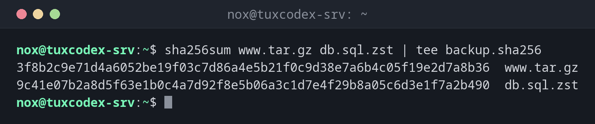

# sha256sum

> Calculates SHA-256 checksums and checks files against them. Proves that a file arrived or was stored without any change.



## Syntax

```bash
sha256sum [OPTION]... [FILE]...
```

`md5sum` and `sha1sum` work the same way, but are considered insecure. Use SHA-256.

## Options

| Option | Description |
|--------|-------------|
| *(none)* | Print the checksum and file name |
| `-c FILE` | Check the files listed in `FILE` |
| `--quiet` | With `-c`: only report errors |
| `--ignore-missing` | With `-c`: skip files that don't exist |

## Examples

**Calculate checksums and save them:**

```bash
sha256sum www.tar.gz db.sql.zst | tee backup.sha256
```

```text
3f8b2c9e71d4a6052be19f03c7d86a4e5b21f0c9d38e7a6b4c05f19e2d7a8b36  www.tar.gz
9c41e07b2a8d5f63e1b0c4a7d92f8e5b06a3c1d7e4f29b8a05c6d3e1f7a2b490  db.sql.zst
```

**Check the files on the target server:**

```bash
sha256sum -c backup.sha256
```

```text
www.tar.gz: OK
db.sql.zst: OK
```

**A damaged file:**

```bash
sha256sum -c backup.sha256
```

```text
www.tar.gz: OK
db.sql.zst: FAILED
sha256sum: WARNING: 1 computed checksum did NOT match
```

`db.sql.zst` was changed or damaged during the transfer. Copy it again.

## When do I need it?

- After copying a backup to another server, to make sure it arrived intact
- To check a download against the checksum the vendor publishes
- To notice later whether an archive was damaged

!!! tip "Keep the checksum with the backup"
    Write the checksum into a file next to the archive: `sha256sum www.tar.gz > www.tar.gz.sha256`.
    Before restoring, `sha256sum -c` tells you whether the archive is still intact.

!!! warning "Checksums only detect, they don't protect"
    Someone who can change the file can also change the checksum file next to it. For
    downloads, compare with a checksum from a trusted source, ideally signed with GPG.

## Related commands

[tar](tar.md) · [rsync](../12-ssh/rsync.md) · [scp](../12-ssh/scp.md)
