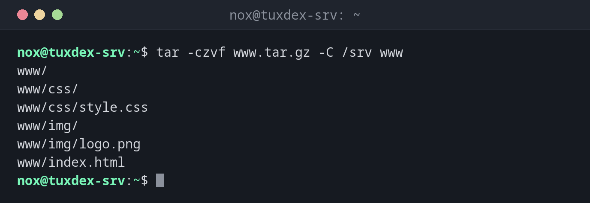

# tar

> Packs files and directories into one archive and unpacks it again, keeping permissions, owners and dates. Combined with a compressor, it is the standard backup format on Linux.



## Syntax

```bash
tar [OPTION]... [FILE]...
```

Remember the order: `c` create, `x` extract, `t` list. `f` must be followed directly by the file name.

## Options

| Option | Description |
|--------|-------------|
| `-c` | Create an archive |
| `-x` | Extract an archive |
| `-t` | List the content |
| `-f FILE` | The archive file, always needed |
| `-v` | List the files while working |
| `-z`, `-j`, `-J`, `--zstd` | Compress with gzip, bzip2, xz or zstd |
| `-C DIR` | Change to this directory first, e.g. to extract into it |
| `--exclude=PATTERN` | Skip matching files |
| `-p` | Keep permissions when extracting (default for root) |

## Examples

**Pack a directory into a compressed archive:**

```bash
tar -czvf www.tar.gz -C /srv www
```

```text
www/
www/css/
www/css/style.css
www/img/
www/img/logo.png
www/index.html
```

**Show the content of an archive:**

```bash
tar -tzvf www.tar.gz
```

```text
drwxr-xr-x nox/nox           0 2026-10-26 10:15 www/
drwxr-xr-x nox/nox           0 2026-10-26 10:15 www/css/
-rw-r--r-- nox/nox        3092 2026-10-26 10:15 www/css/style.css
drwxr-xr-x nox/nox           0 2026-10-26 10:15 www/img/
-rw-r--r-- nox/nox       40000 2026-10-26 10:15 www/img/logo.png
-rw-r--r-- nox/nox       28893 2026-10-26 10:15 www/index.html
```

**Extract into a different directory:**

```bash
mkdir -p /tmp/restore
tar -xzvf www.tar.gz -C /tmp/restore
```

```text
www/
www/css/
www/css/style.css
www/img/
www/img/logo.png
www/index.html
```

**Extract a single file:**

```bash
tar -xzvf www.tar.gz -C /tmp/restore www/css/style.css
```

```text
www/css/style.css
```

**Create a zstd archive without the images:**

```bash
tar --zstd -cf www.tar.zst --exclude=www/img -C /srv www
tar -tf www.tar.zst
```

```text
www/
www/css/
www/css/style.css
www/index.html
```

**Compare an archive with the files on disk:**

```bash
tar -dzf www.tar.gz -C /srv
```

```text
www/index.html: Mod time differs
www/index.html: Size differs
```

`index.html` was changed after the backup.

## When do I need it?

- For backups of directories, for example `/etc`, `/srv/www` or a home directory
- To move a directory with all permissions to another server
- To unpack software that is distributed as `.tar.gz` or `.tar.xz`

!!! tip "Relative paths in the archive"
    Change into the parent directory with `-C` or `cd` before archiving. Then the archive
    contains `www/...` instead of `home/nox/srv/www/...`, and you can unpack it anywhere.

!!! warning "Extracting overwrites"
    `tar -x` overwrites existing files without asking. Check the content with `tar -tf`
    first, and extract into an empty directory with `-C` if you are unsure.

## Related commands

[gzip](gzip.md) · [zstd](zstd.md) · [zip](zip.md) · [rsync](../12-ssh/rsync.md) · [unzip](unzip.md) · [xz](xz.md)
