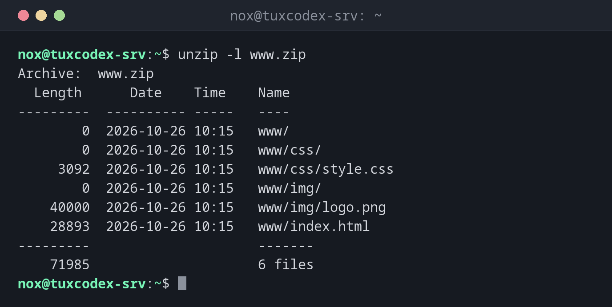

# unzip

> Listet ZIP-Archive auf, prüft und entpackt sie.



## Syntax

```bash
unzip [OPTION]... ARCHIV [DATEI]...
```

## Optionen

| Option | Beschreibung |
|--------|--------------|
| `-l` | Den Inhalt auflisten |
| `-t` | Das Archiv auf Fehler prüfen |
| `-d VERZ` | In dieses Verzeichnis entpacken |
| `-o` | Vorhandene Dateien ohne Rückfrage überschreiben |
| `-n` | Vorhandene Dateien nie überschreiben |
| `-q` | Still |

## Beispiele

**Den Inhalt anzeigen:**

```bash
unzip -l www.zip
```

```text
Archive:  www.zip
  Length      Date    Time    Name
---------  ---------- -----   ----
        0  2026-10-26 10:15   www/
        0  2026-10-26 10:15   www/css/
     3092  2026-10-26 10:15   www/css/style.css
        0  2026-10-26 10:15   www/img/
    40000  2026-10-26 10:15   www/img/logo.png
    28893  2026-10-26 10:15   www/index.html
---------                     -------
    71985                     6 files
```

**In ein Verzeichnis entpacken:**

```bash
unzip www.zip -d /tmp/restore
```

```text
Archive:  www.zip
   creating: /tmp/restore/www/
   creating: /tmp/restore/www/css/
  inflating: /tmp/restore/www/css/style.css
   creating: /tmp/restore/www/img/
  inflating: /tmp/restore/www/img/logo.png
  inflating: /tmp/restore/www/index.html
```

**Das Archiv prüfen:**

```bash
unzip -t www.zip
```

```text
Archive:  www.zip
    testing: www/                     OK
    testing: www/css/                 OK
    testing: www/css/style.css        OK
    testing: www/img/                 OK
    testing: www/img/logo.png         OK
    testing: www/index.html           OK
No errors detected in compressed data of www.zip.
```

## Wann brauche ich das?

- Um Dateien zu entpacken, die Kunden oder Kollegen als ZIP schicken
- Um ein Archiv vor dem Entpacken zu prüfen
- Für Software und Plugins, die als ZIP verteilt werden, etwa für Webanwendungen

!!! tip "Erst hineinschauen"
    ZIP-Archive aus Windows haben oft kein oberstes Verzeichnis und verteilen ihre Dateien ins
    aktuelle Verzeichnis. Prüfe mit `unzip -l` und nutze `-d`.

!!! tip "Nicht immer installiert"
    Fehlt der Befehl, installiere das Paket `unzip` mit dem Paketmanager deiner Distribution.

!!! warning "Rückfragen beim Überschreiben"
    Ohne `-o` oder `-n` fragt `unzip` bei jeder vorhandenen Datei: `replace index.html? [y]es,
    [n]o, [A]ll, [N]one, [r]ename`. Entscheide das in Skripten vorab mit `-o` oder `-n`.

## Verwandte Befehle

[zip](zip.md) · [tar](tar.md)
