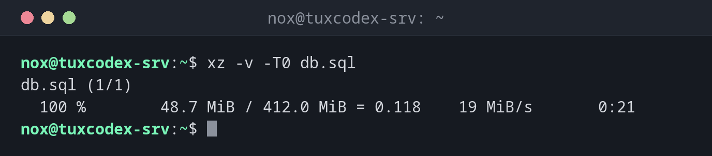

# xz

> Compresses files very strongly, with the smallest results of the common methods. Slow when compressing, fast when unpacking.



## Syntax

```bash
xz [OPTION]... [FILE]...
```

## Options

| Option | Description |
|--------|-------------|
| `-k` | Keep the original file |
| `-d`, `unxz` | Decompress |
| `-v` | Show progress and ratio |
| `-l` | Show information about a `.xz` file |
| `-T0` | Use all CPU cores |
| `-0` … `-9`, `-e` | Level, default `6`; `-e` even stronger and slower |

## Examples

**Compress with all cores and progress:**

```bash
xz -v -T0 db.sql
```

```text
db.sql (1/1)
  100 %        48.7 MiB / 412.0 MiB = 0.118    19 MiB/s       0:21
```

**Show information about the file:**

```bash
xz -l db.sql.xz
```

```text
Strms  Blocks   Compressed Uncompressed  Ratio  Check   Filename
    1      18     48.7 MiB    412.0 MiB  0.118  CRC64   db.sql.xz
```

**Pack a release as `.tar.xz`:**

```bash
tar -cJf app-2.4.1.tar.xz app-2.4.1
ls -lh app-2.4.1.tar.xz
```

```text
-rw-r--r-- 1 nox nox 3.1M Oct 26 10:42 app-2.4.1.tar.xz
```

## When do I need it?

- For files that are compressed once and downloaded often, like software releases
- When every megabyte counts, for example for an archive on slow storage
- To unpack source code and kernel archives, which are often `.tar.xz`

!!! warning "High memory use"
    Strong levels need a lot of memory: `xz -9` uses several hundred MB per core. With
    `-T0` on many cores, that can be too much for a small server.

## Related commands

[zstd](zstd.md) · [gzip](gzip.md) · [tar](tar.md)
