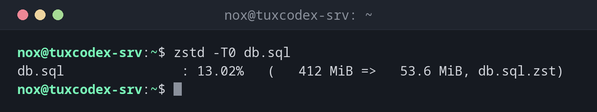

# zstd

> Komprimiert sehr schnell und trotzdem klein. Die moderne Wahl für Backups und Logs.



## Syntax

```bash
zstd [OPTION]... [DATEI]...
```

## Optionen

| Option | Beschreibung |
|--------|--------------|
| `-d`, `unzstd` | Entpacken |
| `--rm` | Das Original nach dem Komprimieren löschen (standardmäßig bleibt es) |
| `-l` | Angaben zu einer `.zst`-Datei zeigen |
| `-T0` | Alle CPU-Kerne nutzen |
| `-1` … `-19` | Stufe, Standard `3` |
| `-o DATEI` | Name der Ausgabedatei |

## Beispiele

**Einen Dump komprimieren:**

```bash
zstd -T0 db.sql
```

```text
db.sql               : 13.02%   (   412 MiB =>   53.6 MiB, db.sql.zst)
```

Anders als gzip behält `zstd` die Originaldatei.

**Angaben zur Datei anzeigen:**

```bash
zstd -l db.sql.zst
```

```text
Frames  Skips  Compressed  Uncompressed  Ratio  Check  Filename
     1      0    53.6 MiB     412 MiB  7.684  XXH64  db.sql.zst
```

**Entpacken:**

```bash
zstd -d db.sql.zst -o restore.sql
```

```text
db.sql.zst          : 432013312 bytes
```

**Ein Backup als `.tar.zst`:**

```bash
tar --zstd -cf etc-2026-10-26.tar.zst -C / etc
ls -lh etc-2026-10-26.tar.zst
```

```text
-rw-r--r-- 1 root root 1.2M Oct 26 10:42 etc-2026-10-26.tar.zst
```

## Wann brauche ich das?

- Für tägliche Backups, bei denen die Geschwindigkeit zählt
- Für große Log-Archive und Datenbank-Dumps
- Immer, wenn du das Verfahren frei wählen kannst: zstd ist eine sehr gute Voreinstellung

!!! tip "Höhere Stufen für Archive"
    `zstd -19 -T0` komprimiert fast so stark wie xz. Das Entpacken bleibt genauso schnell,
    egal welche Stufe genutzt wurde.

!!! tip "Nicht immer installiert"
    Die Bibliothek gehört zu jeder Distribution, der Befehl `zstd` nicht immer. Fehlt er,
    installiere das Paket `zstd`.

## Verwandte Befehle

[tar](tar.md) · [xz](xz.md) · [gzip](gzip.md)
