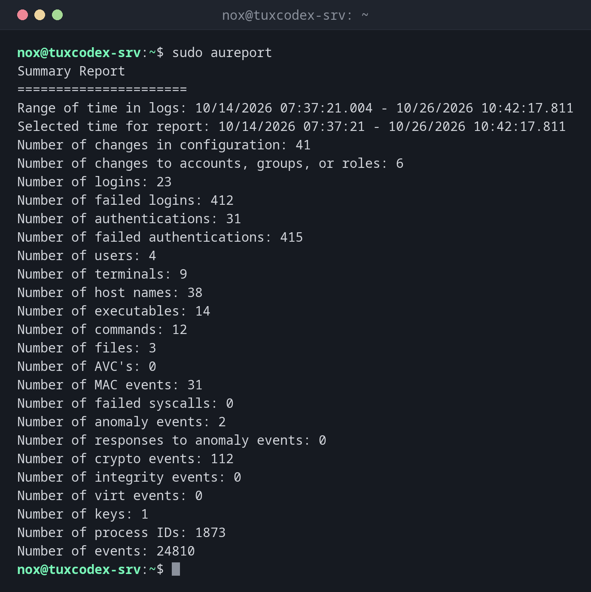

# aureport

> Erstellt Zusammenfassungen aus dem Audit-Log: wie viele Anmeldungen, Fehlversuche, geänderte Konten und andere Ereignisse es gab.



## Syntax

```bash
aureport [OPTION]...
```

## Optionen

| Option | Beschreibung |
|--------|--------------|
| *(keine)* | Gesamtzusammenfassung aller Ereignisse |
| `-au` | Authentifizierungsbericht: jeder Anmeldeversuch |
| `-l` | Anmeldebericht |
| `-m` | Änderungen an Konten und Gruppen |
| `--failed` | Nur fehlgeschlagene Ereignisse |
| `--summary` | Zählung pro Benutzer, Host oder Datei statt einer Liste |
| `-ts`, `-te` | Zeitraum, z. B. `-ts this-week` |

## Beispiele

**Gesamtzusammenfassung:**

```bash
sudo aureport
```

```text
Summary Report
======================
Range of time in logs: 10/14/2026 07:37:21.004 - 10/26/2026 10:42:17.811
Selected time for report: 10/14/2026 07:37:21 - 10/26/2026 10:42:17.811
Number of changes in configuration: 41
Number of changes to accounts, groups, or roles: 6
Number of logins: 23
Number of failed logins: 412
Number of authentications: 31
Number of failed authentications: 415
Number of users: 4
Number of terminals: 9
Number of host names: 38
Number of executables: 14
Number of commands: 12
Number of files: 3
Number of AVC's: 0
Number of MAC events: 31
Number of failed syscalls: 0
Number of anomaly events: 2
Number of responses to anomaly events: 0
Number of crypto events: 112
Number of integrity events: 0
Number of virt events: 0
Number of keys: 1
Number of process IDs: 1873
Number of events: 24810
```

412 fehlgeschlagene Anmeldungen in zwölf Tagen: Der Server wird über SSH angegriffen, wie fast
jeder Server im Internet.

**Alle Anmeldeversuche von heute:**

```bash
sudo aureport -au -ts today
```

```text
Authentication Report
============================================
# date time acct host term exe success event
============================================
1. 10/26/2026 09:58:31 nox 192.0.2.45 ssh /usr/sbin/sshd-session yes 2790
2. 10/26/2026 10:31:02 admin 198.51.100.66 ssh /usr/sbin/sshd-session no 2838
3. 10/26/2026 10:31:05 admin 198.51.100.66 ssh /usr/sbin/sshd-session no 2841
```

**Welche Konten angegriffen wurden:**

```bash
sudo aureport -au --failed --summary
```

```text
Failed Authentication Summary Report
====================================
total  acct
====================================
398  root
12  admin
2  alice
```

## Wann brauche ich das?

- Für einen wöchentlichen Blick auf die Sicherheit eines Servers
- Um schnell zu sehen, ob ein Server angegriffen wird
- Als Ausgangspunkt für [`ausearch`](ausearch.md): Die Ereignisnummer führt zu den Details

!!! tip "Vom Bericht zu den Details"
    Die letzte Spalte vieler Berichte ist die Ereignisnummer. `ausearch -a 2841 -i` zeigt dieses
    Ereignis vollständig.

## Unterschiede zwischen Distributionen

| | Debian | Ubuntu | RHEL | Arch |
|---|--------|--------|------|------|
| auditd installiert und aktiv | nein, Paket `auditd` | nein, Paket `auditd` | ja | nein, Paket `audit` |

## Verwandte Befehle

[ausearch](ausearch.md) · [fail2ban-client](../12-ssh/fail2ban-client.md)
