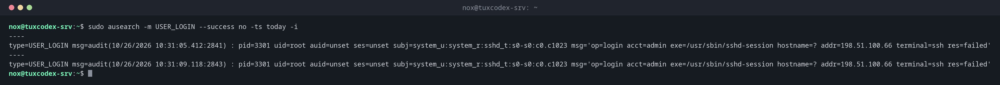

# ausearch

> Searches the audit log of the Linux audit system: logins, changes to watched files, use of `sudo` and other security relevant events.



## Syntax

```bash
ausearch [OPTION]...
```

The audit system records events in `/var/log/audit/audit.log`. With `auditctl -w FILE -p wa -k KEY`, you add a rule that watches a file.

## Options

| Option | Description |
|--------|-------------|
| `-m TYPE` | Event type, e.g. `USER_LOGIN`, `USER_CMD`, `AVC` |
| `-k KEY` | Events of an audit rule with this key |
| `--success no` | Only failed events |
| `-ts`, `-te` | Start and end time, e.g. `-ts today` or `-ts 10:00` |
| `-ua USER` | Events of a user, also after `sudo` |
| `-i` | Translate numbers into names (users, syscalls) |

## Examples

**Find failed logins of today:**

```bash
sudo ausearch -m USER_LOGIN --success no -ts today -i
```

```text
----
type=USER_LOGIN msg=audit(10/26/2026 10:31:05.412:2841) : pid=3301 uid=root auid=unset ses=unset subj=system_u:system_r:sshd_t:s0-s0:c0.c1023 msg='op=login acct=admin exe=/usr/sbin/sshd-session hostname=? addr=198.51.100.66 terminal=ssh res=failed'
----
type=USER_LOGIN msg=audit(10/26/2026 10:31:09.118:2843) : pid=3301 uid=root auid=unset ses=unset subj=system_u:system_r:sshd_t:s0-s0:c0.c1023 msg='op=login acct=admin exe=/usr/sbin/sshd-session hostname=? addr=198.51.100.66 terminal=ssh res=failed'
```

**Watch `/etc/passwd` for changes:**

```bash
sudo auditctl -w /etc/passwd -p wa -k passwd_changes
sudo auditctl -l
```

```text
-w /etc/passwd -p wa -k passwd_changes
```

**Find out who changed the file:**

```bash
sudo ausearch -k passwd_changes -i
```

```text
----
type=PROCTITLE msg=audit(10/26/2026 10:42:17.123:2907) : proctitle=useradd -m bob
type=SYSCALL msg=audit(10/26/2026 10:42:17.123:2907) : arch=x86_64 syscall=openat success=yes exit=5 items=1 ppid=2201 pid=4610 auid=nox uid=root gid=root tty=pts0 ses=4 comm=useradd exe=/usr/sbin/useradd key=passwd_changes
```

`auid=nox` ran `useradd -m bob` with `sudo` at 10:42:17.

## When do I need it?

- After a security incident: who changed which file, and when?
- To prove access to sensitive files, e.g. for compliance
- On RHEL, to find out why SELinux blocked something (`-m AVC`)

!!! tip "`auid` is the real user"
    `uid=root` only shows that a command ran as root. `auid` (audit user) is the user who
    originally logged in, it stays the same after `sudo` and `su`.

!!! warning "Rules are lost at reboot"
    Rules added with `auditctl` are temporary. Write permanent rules into a file in
    `/etc/audit/rules.d/` and load them with `augenrules --load`.

## Distribution differences

| | Debian | Ubuntu | RHEL | Arch |
|---|--------|--------|------|------|
| auditd installed and active | no, package `auditd` | no, package `auditd` | yes | no, package `audit` |

## Related commands

[aureport](aureport.md) · [journalctl](../09-systemd/journalctl.md) · [sudo](../07-users-groups/sudo.md)
