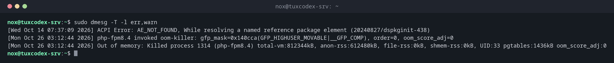

# dmesg

> Shows the messages of the kernel: hardware detection, driver errors, disks, network cards and the OOM killer.



## Syntax

```bash
dmesg [OPTION]...
```

On Debian and Ubuntu, reading the kernel messages requires root: `sudo dmesg`. `journalctl -k` shows the same messages, also from earlier boots.

## Options

| Option | Description |
|--------|-------------|
| `-T` | Human readable time stamps instead of seconds since boot |
| `-l LEVELS` | Only these levels, e.g. `err,warn` |
| `-w` | Follow new messages live |
| `-H` | Readable output with colours and a pager |
| `-c` | Print and clear the buffer (root) |

## Examples

**Show only errors and warnings:**

```bash
sudo dmesg -T -l err,warn
```

```text
[Wed Oct 14 07:37:09 2026] ACPI Error: AE_NOT_FOUND, While resolving a named reference package element (20240827/dspkginit-438)
[Mon Oct 26 03:12:44 2026] php-fpm8.4 invoked oom-killer: gfp_mask=0x140cca(GFP_HIGHUSER_MOVABLE|__GFP_COMP), order=0, oom_score_adj=0
[Mon Oct 26 03:12:44 2026] Out of memory: Killed process 1314 (php-fpm8.4) total-vm:812344kB, anon-rss:612480kB, file-rss:0kB, shmem-rss:0kB, UID:33 pgtables:1436kB oom_score_adj:0
```

**Check whether a new disk was detected:**

```bash
sudo dmesg -T | grep sdd
```

```text
[Mon Oct 26 10:40:51 2026] sd 2:0:0:3: [sdd] 104857600 512-byte logical blocks: (53.7 GB/50.0 GiB)
[Mon Oct 26 10:40:51 2026] sd 2:0:0:3: [sdd] Write Protect is off
[Mon Oct 26 10:40:51 2026] sd 2:0:0:3: [sdd] Write cache: enabled, read cache: enabled, doesn't support DPO or FUA
[Mon Oct 26 10:40:51 2026] sd 2:0:0:3: [sdd] Attached SCSI disk
```

**Without root rights:**

```bash
dmesg
```

```text
dmesg: read kernel buffer failed: Operation not permitted
```

## When do I need it?

- After adding a disk or USB device: was it detected, and under which name?
- When processes disappear: did the OOM killer end them?
- For hardware problems like disk or network errors

!!! tip "Kernel messages of the last boot"
    `dmesg` only knows the current boot. After a crash, `journalctl -k -b -1` shows the
    kernel messages from before the reboot.

!!! warning "OOM killer means: too little memory"
    `Out of memory: Killed process` means the kernel ended a process because memory ran
    out. Find the cause with [`free`](../08-processes/free.md) and [`top`](../08-processes/top.md) instead of only restarting the service.

## Distribution differences

| | Debian | Ubuntu | RHEL | Arch |
|---|--------|--------|------|------|
| Readable without root | no | no | yes | depends on `kernel.dmesg_restrict` |

## Related commands

[journalctl](../09-systemd/journalctl.md) · [lsblk](../13-disks-storage/lsblk.md) · [free](../08-processes/free.md)
