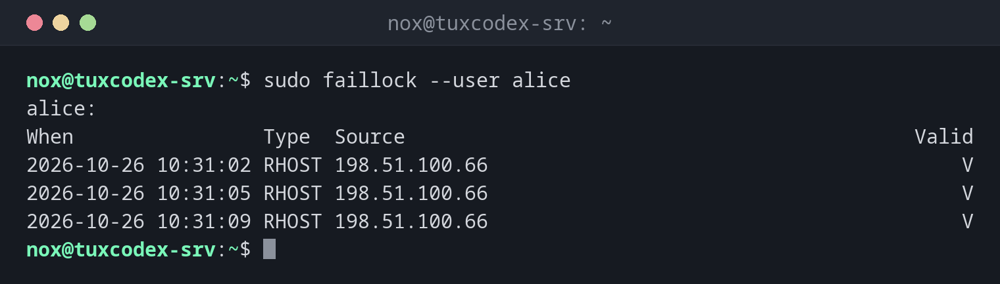

# faillock

> Zeigt fehlgeschlagene Anmeldeversuche pro Benutzer und entsperrt Konten, die nach zu vielen falschen Passwörtern gesperrt wurden.



## Syntax

```bash
faillock [--user BENUTZER] [--reset]
```

`faillock` gehört zum PAM-Modul `pam_faillock`. Es zählt und sperrt nur, wenn dieses Modul in der PAM-Konfiguration aktiv ist, siehe Tabelle.

## Optionen

| Option | Beschreibung |
|--------|--------------|
| *(keine)* | Fehlversuche aller Benutzer |
| `--user BENUTZER` | Nur dieser Benutzer |
| `--reset` | Die Fehlversuche löschen und das Konto entsperren |

## Beispiele

**Die Fehlversuche eines Benutzers anzeigen:**

```bash
sudo faillock --user alice
```

```text
alice:
When                Type  Source                                           Valid
2026-10-26 10:31:02 RHOST 198.51.100.66                                        V
2026-10-26 10:31:05 RHOST 198.51.100.66                                        V
2026-10-26 10:31:09 RHOST 198.51.100.66                                        V
```

Drei Versuche von derselben Adresse innerhalb von Sekunden, `V` markiert sie als gültig für die
Zählung. Mit `deny = 3` ist das Konto jetzt gesperrt.

**Das Konto entsperren:**

```bash
sudo faillock --user alice --reset
sudo faillock --user alice
```

```text
alice:
When                Type  Source                                           Valid
```

**Die Grenzen prüfen:**

```bash
grep -v '^#' /etc/security/faillock.conf | grep .
```

```text
deny = 3
unlock_time = 600
fail_interval = 900
```

Drei Fehlversuche innerhalb von 15 Minuten sperren das Konto für 10 Minuten.

## Wann brauche ich das?

- Wenn sich ein Benutzer nach mehreren Tippfehlern beim Passwort nicht mehr anmelden kann
- Um zu sehen, von wo aus jemand versucht hat, sich an einem Konto anzumelden
- Um ein Konto zu entsperren, nachdem du geprüft hast, dass die Versuche harmlos waren

!!! tip "Einstellungen in `faillock.conf`"
    Wie viele Versuche zur Sperre führen und wie lange sie dauert, steht in
    `/etc/security/faillock.conf`.

!!! warning "Nur lokale und PAM-Anmeldungen"
    Fehlgeschlagene SSH-Anmeldungen mit Schlüsseln oder für nicht existierende Benutzer tauchen
    hier nicht auf. Für SSH-Angriffe schau ins Journal und nutze
    [`fail2ban-client`](../12-ssh/fail2ban-client.md).

## Unterschiede zwischen Distributionen

| | Debian | Ubuntu | RHEL | Arch |
|---|--------|--------|------|------|
| `pam_faillock` standardmäßig aktiv | nein | nein | nein, `sudo authselect enable-feature with-faillock` | ja |

## Verwandte Befehle

[passwd](../07-users-groups/passwd.md) · [fail2ban-client](../12-ssh/fail2ban-client.md) · [last](../01-orientation/last.md) · [ausearch](ausearch.md) · [aureport](aureport.md)
