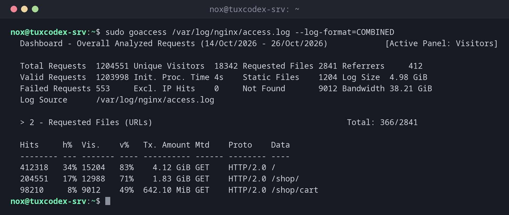

# goaccess

> Wertet Webserver-Logs aus und zeigt Besucher, aufgerufene Seiten, Statuscodes und Bandbreite, live im Terminal oder als HTML-Bericht.



## Syntax

```bash
goaccess [OPTION]... [LOGDATEI]...
```

## Optionen

| Option | Beschreibung |
|--------|--------------|
| `--log-format=COMBINED` | Das Format des Logs, `COMBINED` für die Standards von nginx und Apache |
| `-o report.html` | Einen HTML-Bericht statt der Terminalansicht schreiben |
| `--real-time-html` | Den HTML-Bericht live aktuell halten |
| `-` | Das Log von der Standardeingabe lesen, z. B. von `zcat` |
| `--ignore-crawlers` | Bekannte Bots auslassen |

## Beispiele

**Das Access-Log im Terminal auswerten:**

```bash
sudo goaccess /var/log/nginx/access.log --log-format=COMBINED
```

```text
  Dashboard - Overall Analyzed Requests (14/Oct/2026 - 26/Oct/2026)            [Active Panel: Visitors]

  Total Requests  1204551 Unique Visitors  18342 Requested Files 2841 Referrers     412
  Valid Requests  1203998 Init. Proc. Time 4s    Static Files    1204 Log Size  4.98 GiB
  Failed Requests 553     Excl. IP Hits    0     Not Found       9012 Bandwidth 38.21 GiB
  Log Source      /var/log/nginx/access.log

  > 2 - Requested Files (URLs)                                         Total: 366/2841

  Hits     h%  Vis.    v%   Tx. Amount Mtd    Proto    Data
  -------- --- ------- ---- ---------- ------ -------- ----
  412318   34% 15204   83%    4.12 GiB GET    HTTP/2.0 /
  204551   17% 12988   71%    1.83 GiB GET    HTTP/2.0 /shop/
  98210     8% 9012    49%  642.10 MiB GET    HTTP/2.0 /shop/cart
```

**Einen HTML-Bericht erstellen:**

```bash
sudo goaccess /var/log/nginx/access.log --log-format=COMBINED -o /tmp/report.html
ls -lh /tmp/report.html
```

```text
-rw-r--r-- 1 root root 612K Oct 26 10:42 /tmp/report.html
```

Kopiere die Datei auf deinen Rechner, etwa mit [`scp`](../12-ssh/scp.md), und öffne sie im Browser.

## Wann brauche ich das?

- Um zu sehen, welche Seiten wie oft aufgerufen werden, ohne Tracking-Werkzeug
- Wenn eine Seite langsam oder überlastet ist: Welcher Client oder welche Seite verursacht die Last?
- Für einen schnellen Bericht an einen Kunden, als HTML-Datei

!!! tip "Rotierte Logs einbeziehen"
    `zcat /var/log/nginx/access.log.*.gz | goaccess --log-format=COMBINED -` wertet auch die
    komprimierten alten Logs aus.

!!! warning "Berichte enthalten IP-Adressen"
    Der HTML-Bericht listet Besucher mit ihren IP-Adressen auf. Leg ihn nicht auf einen
    öffentlichen Webserver, oder nutze `--anonymize-ip`.

## Unterschiede zwischen Distributionen

| | Debian | Ubuntu | RHEL | Arch |
|---|--------|--------|------|------|
| Paket | `goaccess` | `goaccess` | aus EPEL | `goaccess` |

## Verwandte Befehle

[lnav](lnav.md) · [zcat](../04-viewing-files/zcat.md) · [awk](../05-text-processing/awk.md)
